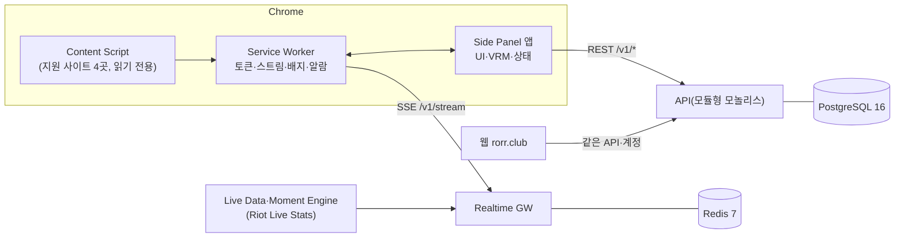

# SPEC.md — RORR 확장 프로그램 v2.0 프로덕션 명세

- 작성일: 2026-10-19 · 상태: v1.0 초안(팀 리뷰 전) · 짝 문서: [intent.md](intent.md)(왜·범위·원칙·게이트)
- 기준 시점: 목업 v47c(`0efdb84`) · 정책 v1.3(2026-10-17) · 공용 API·DB 통합본 `rorr-hero/handoff`(`api/openapi.yaml`·`db/schema.sql`·`api/realtime-events.md`)
- 이 문서의 역할: **구현·검수가 따르는 단일 요구사항 목록**. 각 요구에 ID·수용 기준(AC)·원본 링크를 둠. 화면 치수·문구·애니메이션 값의 상세는 `handoff/`가 원본이며, 이 문서와 다르면 아래 우선순위를 따름

---

## 0. 읽는 법

### 0-1. 우선순위 (충돌 시 위가 이김)

1. 정책 v1.3(`handoff/policy/`) → 2. 통합 결정 목록(`rorr-hero/handoff/09-open-items.md` §0, `docs/07-decision-log.md`) → 3. 공용 API·DB 통합본 → 4. **이 문서** → 5. `handoff/` 화면·상호작용 명세 → 6. 목업 → 7. `docs/02-feature-spec.md`

### 0-2. 표기

| 표기 | 의미 |
|---|---|
| **반드시** | 출시 필수. 미충족 시 해당 단계 완료 불가 |
| **권장** | 출시 후 보완 가능 |
| [플래그] | 서버 기능 플래그 뒤에 구현, 출시 빌드 기본 꺼짐 |
| [결정 대기] | 값·방식 미확정. 현재 가정으로 구현하되 설정값으로 둠 |
| `REQ-영역-번호` | 요구 ID. 커밋·PR·테스트 이름에 사용 |
| `F-xx` | `docs/02-feature-spec.md` 기능 ID |
| `P-`·`S-`·`W-`·`M-` | `handoff/06-qa-checklist.md` 시험 ID |

---

## 1. 시스템 개요



- 클라이언트는 **표시만**. 잔액·차감·카드·배지·포인트·순간 등급·행운 박스 결과·퀴즈 판정은 서버(`intent.md` §6-1)
- 확장 전용 서버 기능: 중계 매칭·실시간 스트림·Muse 대사·지연 보고(`/v1/ext/*`). 나머지는 웹과 공용
- 상세 구성: `handoff/07-system-architecture.md` · 흐름도: `handoff/08-flowcharts.md`

## 2. 플랫폼·환경 전제

| 항목 | 값 |
|---|---|
| 브라우저 | Chrome 114 이상(Side Panel API). 그 외 브라우저 미지원 |
| 패널 폭 | 설계 380px, 최소 320px — 두 폭 모두 가로 스크롤 없음 |
| 언어 | 한국어·영어(계정 기본값 + 로컬 저장), 런타임 전환 |
| 테마 | 다크 단일(중계 옆 시청 맥락) |
| 지원 중계 사이트 | YouTube · 치지직 · SOOP · Twitch (`host` = `youtube|chzzk|soop|twitch`) |
| 권한 | `sidePanel` `storage` `identity` `notifications` `alarms` + 지원 사이트 4곳 + `api.rorr.club`. `<all_urls>` 금지 |
| 배포 | 기존 스토어 항목 업데이트(사용자 승계) |
| 지원 리그 | LCK. 그 외는 S5 '준비 중' |

## 3. 상태 모델

### 3-1. 패널 화면 상태 (`docs/03-ux-flow` §2와 동일 이름)

| 상태 | 진입 조건 | 화면 |
|---|---|---|
| S0 첫 실행 | 설치 직후 | 서하 인사 → 응원 팀 칩(웹 선택 이어받기 OI-19) |
| S1 평시 | 진행 경기 없음·지원 사이트 탭 없음 | 서하 대화 + 오늘 일정 |
| S2 매칭 | 지원 사이트 + 진행 경기 | 자동 매칭 → 실패 시 후보 선택 → 지연 보정 |
| S3 경기 중 | 매칭 완료 | 스코어 줄·서하·퀴즈·큰 순간 알림·Boost |
| S4 세트 사이·경기 후 | 세트·경기 종료 | 경기 요약 |
| S5 비지원 리그 | LCK 외 | 준비 중·알림 신청 |

### 3-2. 시청 상태 (S3 하위, `handoff/16`)

| 상태 | 판정 | 결과형 알림 | Boost |
|---|---|---|---|
| 공식 채널 | 등록 채널 + 라이브 끝 근접 | 개인 지연 후 표시 | 가능 |
| 탭 없음 | 지원 사이트 탭 없음 | 채널 기본 지연 후 | 가능 |
| 다른 방송 | 미등록 채널(코스트리밍 포함) | 채널 기본 지연 후 | 가능 |
| 다시보기 | 라이브 끝에서 `WATCH_REPLAY_BEHIND_S` 이상 뒤 | **표시 안 함** | 가능(안내만) |

### 3-3. Boost 두 번 누르기

```
idle --금액 탭(잔액 충분)--> armed(5s) --같은 금액 재탭--> sending --201--> celebrate --> card
armed --5초 | 금액·재화 변경 | 시트 닫힘 | 순간 마감--> idle
idle --금액 탭(잔액 부족)--> idle + 부족 안내(대기 없음)
sending --오류·8초 초과--> failed --> idle (차감 표시 없음)
```

---

## 4. 기능 요구사항

> 각 표의 '원본'은 화면·문구 상세. AC는 자동·수동 시험으로 확인 가능한 문장으로 씀

### 4-1. 온보딩·계정 (F-01·F-07)

| ID | 요구 | 원본 |
|---|---|---|
| REQ-ONB-01 | **반드시** 로그인 없이 서하 인사 → 응원 팀 선택까지 진행 | F-01 |
| REQ-ONB-02 | **반드시** 로그인은 첫 Boost·직접 질문·순위 열람 시점에 요청(`launchWebAuthFlow` PKCE → `POST /v1/auth/ext/token`) | `handoff/07` §4 |
| REQ-ONB-03 | **반드시** 액세스 토큰 15분·리프레시 30일, 리프레시 회전(`/v1/auth/ext/refresh`), 토큰은 서비스 워커만 보관 | 통합본 |
| REQ-ONB-04 | **반드시** 비로그인 팀 선택은 로컬 저장 후 로그인 시 `PUT /v1/me/teams`로 병합. 복수 응원 팀 + 대표 팀 | F-07, 정책 §5-2 |
| REQ-ONB-05 | **반드시** `min_ext_version` 미만이면 업데이트 안내 화면, 기능 잠금 | `GET /v1/config` |
| REQ-ONB-06 | **반드시** 미성년 계정은 Energy Boost·충전 진입·행운 박스 미노출, 순위·메인 노출 기본 끔 | 정책 §7 |

- AC: 설치 → 팀 선택 탭 3회 이내·로그인 요구 0회 / 웹에서 바꾼 응원 팀·잔액이 30초 안에 반영(`wallet.changed`·재조회) / 비로그인에서 Boost 누르면 시트 대신 로그인 안내(잔액 0 표시 금지)

### 4-2. 중계 매칭·시청 상태·지연 (F-03 일부·v46)

| ID | 요구 | 원본 |
|---|---|---|
| REQ-WATCH-01 | **반드시** 콘텐츠 스크립트는 호스트·URL·제목·재생 상태·라이브 끝까지 거리(`video.seekable.end − currentTime`)만 2초 주기로 전달. DOM 변경 금지 | `handoff/12` §4-1 |
| REQ-WATCH-02 | **반드시** `POST /v1/ext/match/resolve`로 매칭(matched/ambiguous/none). ambiguous는 후보 2~3개 칩 | F-2 흐름 |
| REQ-WATCH-03 | **반드시** 시청 상태 4종(§3-2)을 `WATCH_STATE_HOLD_MS`(3초) 유지 후 반영, 띠 문구는 `handoff/02` §17 | `handoff/16` §2 |
| REQ-WATCH-04 | **반드시** 탭 없음·다른 방송에서 공식 채널 목록(사용자 언어 우선) 제공, 선택 시 새 탭으로 열기 | `handoff/02` §17 |
| REQ-WATCH-05 | **반드시** 개인 지연 = 채널 기본 지연 + 라이브 끝 뒤처짐 + 1탭 보정(±2초, 로컬 저장·경기·채널별) | `handoff/16` §3 |
| REQ-WATCH-06 | **반드시** 예고형 이벤트(`moment.upcoming`·`quiz.opened`)는 즉시, 결과형(`moment.resolved`·`match.state`·`quiz.resolved`·킬·오브젝트 대사)은 `server_ts + 개인 지연` 도달 후 표시. 다시보기에서는 결과형 폐기 | docs/04 §4 |
| REQ-WATCH-07 | **반드시** 1탭 보정 값은 `POST /v1/ext/offset-reports`로 익명 보고(사용자 ID 미포함) | 통합본 |
| REQ-WATCH-08 | **반드시** 큰 순간 중에는 시청 상태 띠를 32px 칩으로 접고 누르면 알림 아래 펼침 | `handoff/02` §18 |
| REQ-WATCH-09 | [결정 대기] 경기별 공식 채널 목록·`broadcast.offset` 이벤트·측정 테이블은 통합본 변경 요청 C-1~C-10 반영 후 연결. 반영 전에는 매칭 응답의 기본 오프셋만 사용 | `handoff/16` §4 |

- AC: 결과형 이벤트가 개인 지연 전에 화면에 나온 사례 0(S-07) / 다시보기 상태에서 결과형 알림 0(W-04) / 탭 전환·버퍼링으로 띠 깜박임 0(W-06) / 중계 URL은 매칭 후 서버에서 폐기

### 4-3. 서하(Muse) (F-02·F-15)

| ID | 요구 | 원본 |
|---|---|---|
| REQ-MUSE-01 | **반드시** VRM 3D 렌더러(모델·애니메이션 동봉, 원격 로드 금지), `CompanionRenderer` 인터페이스, 저사양·패널 숨김 시 정지 이미지·렌더 정지 | docs/04, `handoff/12` §6 |
| REQ-MUSE-02 | **반드시** 감정 5단계 calm/happy/sad/tense/hype, 트리거 = 오브젝트·한타·바론/장로 시도·스틸·진격·세트 종료 | F-02 |
| REQ-MUSE-03 | **반드시** 대사에 수치 없음, 선수 판정·상대 비하 금지, 스폰서 문구를 서하가 말하지 않음 | F-02, 정책 §6-1 |
| REQ-MUSE-04 | **반드시** 순간 대사는 `GET /v1/ext/muse/lines` 세그먼트 캐시(버전 단위) | 통합본 |
| REQ-MUSE-05 | **반드시** 말풍선 `aria-live="polite"`, 7초 후 숨김, 보이는 중 교체 시 150ms 흐림 교차 | `handoff/11` §1 |
| REQ-MUSE-06 | **권장**(P1) 관계 기억은 로컬 IndexedDB에만 저장, 다음 경기 첫 인사에 1회 회상 | F-15 |

- AC: 레드팀 문장 세트(선수 판정·상대 비하·수치 낭독·스폰서 언급) 위반 0건

### 4-4. 경기 중 화면 (F-03·F-05)

| ID | 요구 | 원본 |
|---|---|---|
| REQ-LIVE-01 | **반드시** 스코어 줄: 팀·킬·게임 시각·골드 격차 막대(가운데 기준 `scaleX`), 팀 탭 → 상세 팝오버(팀 페이지·연속 정답·중계 맞춤) | `handoff/02` §1 |
| REQ-LIVE-02 | **반드시** 비제휴 팀은 팀명 텍스트만(로고·고유 색 없음), '비제휴 팀' 표기 | 정책 §0·§2 |
| REQ-LIVE-03 | **반드시** 하단 입력 바: 오늘의 모먼트(카드 수 배지) · 빠른 반응 · '서하에게 묻기' 입력 · Boost(44px). 하단 탭 없음 | `handoff/02` §0 |
| REQ-LIVE-04 | **반드시** 빠른 반응(Cheer/Ugh/LET'S GO)은 무료·비로그인 가능·포인트 미반영. 집계 공개는 [결정 대기 OI-18] | F-05 |
| REQ-LIVE-05 | **반드시** 오늘의 모먼트 패널: 경기 순간 목록, 제자리 펼침(위로 튀지 않음) | `handoff/02` §10 |
| REQ-LIVE-06 | **반드시** 실시간 연결 상태 표시: 재연결 3초 이상 '연결 중…' 띠, 오프라인 시 Boost·퀴즈 비활성 + '연결이 끊겼어요' | `handoff/11` §8 |

- AC: 스코어 갱신 지연 ≤ 개인 지연 + 2초 / 320·380px에서 줄바꿈·잘림 없음

### 4-5. 큰 순간 알림 (F-04)

| ID | 요구 | 원본 |
|---|---|---|
| REQ-HEADS-01 | **반드시** `moment.upcoming` 수신 시 상단 알림(순간명 + `HEADSUP_COUNTDOWN_S` 카운트다운), Boost 버튼 강조(미리 그린 고리 투명도 반복) | `handoff/02` §5 |
| REQ-HEADS-02 | **반드시** 큰 순간 중 상단 순서 = 스코어 → 알림 → 후원 줄(플래그) → (펼친 경우) 시청 상태. 코치마크 숨김 | `handoff/02` §18 |
| REQ-HEADS-03 | **반드시** 알림 수준 `alert_level` = `all` / `holo`(화면 '결정적 순간만') / `off`, 웹과 동기화 | 통합본 E-2 |
| REQ-HEADS-04 | **반드시** 빈도 상한은 서버 판정(`EXT_HEADSUP_MIN_GAP` [결정 대기, 90초 제안]), 노출·클릭·닫기는 `POST /v1/headsup/impressions` | 통합본 |
| REQ-HEADS-05 | **반드시** `moment.cancelled`는 조용히 철회, 카운트다운 0에서 160ms 퇴장 | `handoff/11` §1 |
| REQ-HEADS-06 | **반드시** 패널 닫힘 시 푸시 알림 없이 확장 아이콘 배지만 | 정책 §5-4 |
| REQ-HEADS-07 | **반드시** 퀴즈가 열려 있으면 알림 전에 퀴즈 마감(화면 경쟁 금지) | F-20 |

- AC: 큰 순간 + 시청 상태 안내가 겹쳐도 상단 높이 150px 이하(W-11) / 경기 중 푸시 0건

### 4-6. Boost (F-06)

| ID | 요구 | 원본 |
|---|---|---|
| REQ-BOOST-01 | **반드시** 시트 진입 시 `GET /v1/boost-context`로 서버 판정값(파트너 여부·허용 재화·고지·누적·박스 여부)을 받아 그림 | 통합본 |
| REQ-BOOST-02 | **반드시** 재화 세그먼트 Energy/Spark, 금액은 `STEP_ENERGY`(10/50/100/500)·`STEP_SPARK`(5/10/20/50)만. 비제휴 팀 경기는 Spark만 + 고지 | 정책 §2 |
| REQ-BOOST-03 | **반드시** Boost 가능 Energy = **유료 Energy만**. 보너스만 있으면 '유료 Energy만 쓸 수 있어요' + 웹 충전 링크 | 정책 v1.3 §1-1 |
| REQ-BOOST-04 | **반드시** 두 번 누르기(§3-3), `BOOST_CONFIRM_WINDOW_MS`(5초) 링, 2차 탭에서만 `POST /v1/boosts` + `Idempotency-Key`(재시도는 같은 키) | `handoff/05` §5 |
| REQ-BOOST-05 | **반드시** 시트 1줄 구성: 카드 주인공 줄(★ 선수 + ⓘ) · 첫 Boost/재Boost 안내 1줄 · 차감 줄('사용 즉시 소진 · 환불 불가 · 파트너 수익 배분' + ⓘ). 배분 비율 미표기 | `handoff/02` §6 |
| REQ-BOOST-06 | **반드시** 성공 시 축하(첫 0.9초·재Boost 0.7초, 입자 실버 16·골드 28·홀로 40) → 카드 공개. 실패 시 '보내지 못했어요. 차감되지 않았어요.' + 재시도 | `handoff/02` §7 |
| REQ-BOOST-07 | **반드시** 재Boost: 카드 추가 발급·포인트 없음, 재화별 누적으로 배지 단계 갱신('{재화} {n}단계 · 이 순간 누적 {합계} · {다음}단계까지 {차이} 남음') | 정책 §4 |
| REQ-BOOST-08 | **반드시** 확정 방식은 `BOOST_SETTLE_MODE`: `immediate`(201) / `on_moment`(202 + `boost.settled`·`boost.voided`) 둘 다 처리 | OI-13 |
| REQ-BOOST-09 | **반드시** 응원 메시지 동시 작성(선택), 최대 `MESSAGE_MAX_CHARS`(통합본 80, [결정 대기 D-9]), 금칙어 거절 시 '보낼 수 없는 표현이 있어요' | 통합본 |
| REQ-BOOST-10 | **반드시** 충전·Spark 획득은 웹 링크. 포커스 복귀 시 잔액 재조회, 순간이 열려 있으면 시트 다시 열기 | `handoff/02` §14 |
| REQ-BOOST-11 | **반드시** 시트 진입 260ms(키보드 `B`는 애니메이션 없음)·퇴장 200ms, 닫는 중 재열기 시 취소 | `handoff/11` §1 |

- AC: 같은 순간 재Boost에서 카드·포인트 중복 0, 배지 단계 = 누적 합계 기준(S-01·S-04) / 같은 키 2회 → Boost 1건(S-03) / 보너스만 있는 계정에서 보너스 차감 0(S-02) / 실패 시 화면 잔액 변화 0

### 4-7. 카드·내 선수 (F-08·F-08a·v35~v44)

| ID | 요구 | 원본 |
|---|---|---|
| REQ-CARD-01 | **반드시** 카드 공개: 앞면(순간·시각·스코어·주인공·등급 테두리·배지) / 뒷면, 클릭·`Enter`로 뒤집기, 닫기 180ms | `handoff/02` §8 |
| REQ-CARD-02 | **반드시** 등급 = 순간 크기(실버·골드·홀로그램), Boost 시점 등급으로 고정(BE-2 가정), 무작위·판매·거래 없음, 카드에 브랜드 없음 | 정책 §4·§6-1 |
| REQ-CARD-03 | **반드시** 카드 주인공 = 내 선수가 교전 참여 시 내 선수, 아니면 기여도 1위. 첫 Boost에서 고정. 비제휴 = RORR 모먼트 카드(선수 없음) | `handoff/05` §4 |
| REQ-CARD-04 | **반드시** 내 선수는 경기 첫 진입 시 1회 묻기(선수 5명 + '자동으로 둘게요'), 메뉴에서 변경, `PUT /v1/me/my-player`(팀별, null = 자동). 묻기 빈도 [결정 대기 EXT-1] | `handoff/02` §3 |
| REQ-CARD-05 | **반드시** 기념 에디션: 선수 페이지 응원 탭 '기념할 순간'(경기 중에도 표시), 기념 기간 ±3일·기념일당 1장, 파트너 팀 선수만(`GET /v1/players/{id}/milestones`) | F-08a |
| REQ-CARD-06 | **반드시** 웹·확장 발급 카드가 같은 컬렉션·같은 렌더링(`@rorr/ui`) | F-08 |

- AC: 카드 주인공 판정 3경우(일치·미참여·자동) 문구가 `handoff/05` §4와 일치 / 기간 밖 기념 Boost 0건

### 4-8. 퀴즈·순위 (F-20·F-21)

| ID | 요구 | 원본 |
|---|---|---|
| REQ-QUIZ-01 | **반드시** `quiz.opened` 수신 시 퀴즈 카드(2지선다·`QUIZ_WINDOW_S` 12초), 동시 1문항, 무료·재화 없음, 비로그인 응답 가능 | F-20 |
| REQ-QUIZ-02 | **반드시** 응답은 `POST /v1/quiz/{question_id}/answers`, 정답·점수는 `quiz.resolved`로만 수신. `quiz.void`는 '너무 빨리 일어나서 이번 문항은 집계하지 않아요' | 통합본 |
| REQ-QUIZ-03 | **반드시** 판정·마감은 서버 시각. 결과가 실제로 일어난 데이터 시각 이후 응답은 무효(개인 지연과 무관) | `handoff/16` §3 |
| REQ-QUIZ-04 | **반드시** 스트릭: 정답 +1, 오답 0, 미응답 유지, 경기를 넘어 이어짐. 점수 = 10 + 스트릭 × 5(상한) — 응원 포인트와 별도 집계 | F-20 |
| REQ-QUIZ-05 | **반드시** 순위(`GET /v1/quiz/ranking`): 주간 퀴즈 포인트, 동점 = 주간 최장 스트릭 → 먼저 도달. 금액 환산 표기 금지 | F-21 |
| REQ-QUIZ-06 | **반드시** 상금 상위 10명·총 30 Spark(`QUIZ_PRIZE_*`), 공식 규칙 `#rules/quiz` 게시 전 지급 금지, 만 14세(한)·13세(미) 미만 상금 미지급 | F-21, G-9~G-12 |
| REQ-QUIZ-07 | **반드시** 선수 개인의 실수·데스를 맞히는 문항 금지, 비제휴 팀 문항은 팀 식별 수준만 | F-20 |

- AC: 결과 공개 후 응답 가능 문항 0 · 선수 판정형 문항 0 · 재화 차감 0 · 순위표 금액 표기 0

### 4-9. 경기 요약·팀·순위 화면 (F-13·v30)

| ID | 요구 | 원본 |
|---|---|---|
| REQ-PAGE-01 | **반드시** 경기 요약(S4): 오늘 받은 카드·내 포인트 변화·가장 큰 승부처·다음 경기 안내 | `handoff/02` §12 |
| REQ-PAGE-02 | **반드시** 팀 페이지(파트너/비제휴), 서포터 순위(`GET /v1/teams/{id}/rankings`, 비제휴는 Spark 기준 비공식), 팬덤(`/fandom`, 비율 미포함) | `handoff/02` §11 |
| REQ-PAGE-03 | **반드시** 응원 포인트 = 순간당 1회 +20 + 등급 +10/+30/+60 + 연속 응원(첫 경기 0, 2경기째부터 +10, 최대 +100) — 표시만, 계산은 서버 | 정책 §5-3, BE-1 |
| REQ-PAGE-04 | **반드시** 두 팬덤 대결 구도(게이지·VS 비교) 금지 | 정책 §5-2 |

### 4-10. 알림·메뉴·설정 (F-09·F-10·F-22)

| ID | 요구 | 원본 |
|---|---|---|
| REQ-SET-01 | **반드시** 경기 시작 알림: 응원 팀 경기만(v2.1에서 별도 옵트인 '리그 전체 일정 알림' 추가 예정 — REQ-VIEW-11), 옵트인, 시작 10분 전 1회, 한 사용자 한 채널(`PUT /v1/me/match-alerts`), `chrome.alarms`로 일정 동기화 1시간 | F-09 |
| REQ-SET-02 | **반드시** 확장 알림 채널은 경기 시작 알림 전용(광고·소식 금지) | F-22 |
| REQ-SET-03 | **반드시** 메뉴: 계정(잔액·계정·로그아웃 ↗) · 설정(언어·알림 수준·내 선수·중계 맞춤·경기 시작 알림 ↗) · rorr.club(카드·응원 팀·충전·Spark·결제·환불·도움말·알림함 ↗ + 미읽음 수) · 고지 'An independent fan companion. Not endorsed by Riot Games.' | `handoff/02` §13 |
| REQ-SET-04 | **반드시** 메뉴 항목이 패널을 넘으면 스크롤(항목 압축 금지) | W-10 |

- AC: 응원 팀 외 알림 0 · 옵트인 없는 알림 0 · 채널 간 중복 0 · 확장 경유 광고성 알림 0

### 4-11. 서하 대화·질문 (F-11, P1)

| ID | 요구 | 원본 |
|---|---|---|
| REQ-ASK-01 | **권장** 추천 질문 칩(무료·캐시) + 직접 입력(`POST /v1/ext/muse/chat`, 로그인 필요, **Energy 차감 없음**, 분당 10회 제한), 경기·세트·게임 시각 자동 첨부 | 정책 v1.3 §1, EXT-2 |
| REQ-ASK-02 | **권장** 답변 = 서하 1문장 + 펼침(근거·지표 칩·타임스탬프). '누가 못했는지' 답하지 않음 | F-11 |

### 4-12. 스폰서 행운 박스 [플래그 `sponsor_moment_enabled`] (F-23)

| ID | 요구 | 원본 |
|---|---|---|
| REQ-BOX-01 | 노출 조건(서버 판정): 파트너 경기 + 골드 이상 순간 + 계약 범위 + 풀 잔량 + 로그인 + 미성년 아님 + 대조군 아님 | `handoff/05` §7 |
| REQ-BOX-02 | 큰 순간 알림 아래 후원 줄 1줄(44px, '후원' 배지 항상), 패널 안 모달(좌우 여백 28px 이상, 최대 304px)에서 진행, 확률 상시 표시('어느 박스든 확률은 같아요') | `handoff/02` §9 |
| REQ-BOX-03 | `POST /v1/sponsor/boxes`, 결과는 서버 난수·알림당 1회·같은 순간 재요청은 첫 결과. 박스 위치는 보내지 않음 | 통합본 |
| REQ-BOX-04 | 결과 후 시트 재화 자동 선택(당첨 → Spark N, 꽝 → Energy 10, 응답 `next`), 카드·배지·포인트에 직접 영향 없음 | 통합본 E-4 |
| REQ-BOX-05 | `sponsor.pool` 이벤트로 버튼 숨김·표시(라벨은 유지), 컷인 후원 표시는 카드보다 아래 층 | 통합본 |

- AC: 확률 상시 노출 · 재화 소모 0 · 미성년 노출 0 · 카드 앞·뒷면 브랜드 0

---

### 4-13. 시청 확장 v2.0 (2026-10-20, `handoff/17`)

| ID | 요구 | 원본 |
|---|---|---|
| REQ-VIEW-01 | **반드시** 동반 시청 1분 = 패널 열림 + 매칭 + 시청 상태 공식 채널 + 재생 중 + 중계 탭 보임. 다른 상태는 별도 분으로 집계 | `handoff/17` §2-1 |
| REQ-VIEW-02 | **반드시** `watch_session_start` · `watch_heartbeat`(재생 중 60초마다) · `watch_session_end` 전송, `phase`(pre/live/between/post)·`is_cheer_team` 포함 | §5 |
| REQ-VIEW-03 | **반드시** 패널 닫힘 상태 시청 측정은 별도 동의자만(동의 철회 즉시 중단) | §5, G-6 |
| REQ-VIEW-04 | **반드시** 경기 요약 상단 '이어서 보기': 다음 경기까지 남은 시간 + 공식 채널 버튼 + '시작하면 알려 줘'(이 경기 1회). 다음 경기가 없으면 다음 일정 | §3 |
| REQ-VIEW-05 | **반드시** 순위 맥락 한 줄(경기 전·세트 사이·다른 경기 카드): 서버 문구 키 + 변수. '내 팀에 미치는 영향'만, 팀 간 비교 게이지·상대 팬덤 언급 금지 | §3, 정책 §5-2 |
| REQ-VIEW-06 | **반드시** 세트 사이(S4): 그 세트의 큰 순간 3개(카드 축약) + 다음 세트 첫 퀴즈 예고. 하이라이트 영상은 플랫폼 링크만 | §3 |
| REQ-VIEW-07 | **반드시** 실험 배정(사용자 단위 무작위, 기능별 대조군 5~10%)을 `GET /v1/config` 또는 별도 배정 응답으로 받아 기능 노출을 끔. 대조군에 불이익 없음 | §4-2 |
| REQ-VIEW-08 | **반드시** 첫 실행·월 1회 설문 1문항('지난 4주 LCK 몇 경기를 봤나요', 생방송·다시보기), 건너뛰기 가능 | §4-2 L3 |
| REQ-VIEW-09 | **반드시** 리포팅: 내부 주간 대시보드 + 파트너 월간 리포트, 집계 최소 50명, 기준선 층·표본·신뢰 구간 표기, 배분 비율·개인 Boost 금액 제외 | §7 |

- AC: 동반 시청 분이 수동 측정(녹화 대조) 대비 ±5% 이내 / 대조군 사용자에게 해당 기능 노출 0 / 50명 미만 집계 셀 노출 0 / 미동의자의 패널 닫힘 측정 0

### 4-14. 시청 확장 v2.1 (개막 후 4~8주 — **권장**, 정책 개정 후)

| ID | 요구 | 원본 |
|---|---|---|
| REQ-VIEW-10 | 경기 전 진입: 시작 카운트다운, 서하 매치업 한 줄(수치는 스트립·펼침), 라인업 발표 시 퀴즈 1문항, '시작하면 이 채널 열기' 예약 | §3 |
| REQ-VIEW-11 | 리그 전체 일정 알림: 별도 옵트인(기본 끔), 하루 상한 `LEAGUE_ALERT_DAILY_CAP`, 한 사용자 한 채널 — **정책 §5-5 개정 전 구현 금지** | §6 |
| REQ-VIEW-12 | 서하 리그 모드: 응원 팀이 아닌 경기에서 중립 말투, 양 팀 플레이, 순위 맥락 연결 | §3 |
| REQ-VIEW-14 | 팬 드래프트: 최근 밴픽 기반 예상으로 미리 채운 밴 3·픽 5를 두 단계로 확정(① 보드에서 고치기: 후보 트레이·검색·랜덤 채우기 ② ★ 1개 고르기), 밴픽 시작 전 마감, 경기 시작 시 실제와 비교. 맞힌 만큼 주간 퀴즈 포인트(바꾼 칸·★ 5, 그대로 둔 칸·자동 채움 2), **Spark 직접 지급 금지**(`17` §3-1) | `02` §19 |
| REQ-VIEW-14a | 팬 드래프트 처음 안내: 첫 열기 1회 '밴픽' 정의(밴 3 = 상대가 못 쓰게 막기, 픽 5 = 선수별 챔피언)·하는 법 3단계·보상 한 줄, '?'로 다시 보기. 보드 설명 줄, 후보 횟수는 '10경기 중 n회'와 뜻을 문장으로 | `02` §19-4 |
| REQ-VIEW-15 | 밴픽 리뷰: 서하 한 문장 요약 + 비교(참여자, ★ 결과·바꾼 칸 적중·희소 적중) + 지켜볼 포인트 3개, 공유 문구(★·희소 적중 중심, 금액·팬덤 비교 없음). 퀴즈가 열리면 닫힘 | `02` §19 |
| REQ-VIEW-16 | 지켜볼 포인트: 서버가 조합 기반으로 3개 생성, 경기 중 달성 이벤트로 체크·토스트, 오늘의 모먼트 패널·경기 요약에 표시. 결과형 이벤트라 개인 지연 후 표시 | `17` §3 |
| REQ-VIEW-17 | 팬 드래프트 카드: 경기 종료 시 경기 요약에서 1회 자동 공개(이후 요약의 카드 줄·'내 기록 › 팬 드래프트'에서 다시 보기). 내용 = 일치 수·★ 결과·밴픽 보드(적중 ✓·감독 선택·바꾼 칸 표시)·희소 적중·칭호·T1 팬 상위 %. 이미지 저장(1080×1350)·공유. **포인트·Spark·금액·상대 팬덤 비교 표기 금지, 모먼트 카드함·카드 수 순위 제외** | `02` §19-3 |
| REQ-VIEW-18 | 퀴즈 기록 캘린더: 메뉴 '내 기록'에서 월 단위로 응원 팀 경기의 퀴즈 참여(맞힌 수)·미참여·예정 표시, 날짜 상세(정답·퀴즈 포인트·팬 드래프트·카드 열기, 예정 경기 알림). 놓친 경기 비난 문구 금지. API C-12(개발팀 구현분과 대조) | `02` §20 |
| REQ-VIEW-13 | 다른 경기 순간 칩: 동시간대·다음 경기의 홀로그램 순간만 패널 안 1줄, 결과·스코어 숨김, 푸시 금지 | §3·§6 |

## 5. 설정값 (`GET /v1/config` — 하드코딩 금지)

| 이름 | 값 | 상태 |
|---|---|---|
| `STEP_ENERGY` / `STEP_SPARK` | [10,50,100,500] / [5,10,20,50] | 확정 |
| `BADGE_ENERGY_L2`·`L3` / `BADGE_SPARK_L2`·`L3` | 50·100 / 20·50 (1단계 = 첫 Boost) | 1차값 |
| `BOOST_CONFIRM_WINDOW_MS` | 5000 | 확정 |
| `BOOST_SETTLE_MODE` | `immediate` | 결정 대기(OI-13) |
| `BOOST_GRACE_MS` | 0(확장 제안: 채널 기본 지연 기준 상한 30000) | 결정 대기(BE-4) |
| `HEADSUP_COUNTDOWN_S` | 40 | 확정 |
| `EXT_HEADSUP_MIN_GAP` | 90 | 제안 |
| `MOMENT_TIER_GOLD_PP` / `HOLO_PP` | 12 / 30 | 결정 대기(D-3) |
| `QUIZ_WINDOW_S` / `QUIZ_GRACE_MS` | 12 / 0 | 실측 후(OI-27) |
| `QUIZ_PRIZE_TOP_N` / `QUIZ_PRIZE_POOL` | 10 / 30 | 1차 운영값 |
| `SPONSOR_BOX_ODDS` | 꽝 75 · Spark 5 20 · Spark 10 5 | 임시 |
| `MESSAGE_MAX_CHARS` | 80 | 결정 대기(D-9) |
| `WATCH_REPLAY_BEHIND_S` / `WATCH_STATE_HOLD_MS` / `OFFSET_STEP_MS` | 60 / 3000 / 2000 | 제안(C-8) |
| `BONUS_ENERGY_SCOPE` | `rorr_deco` | 확정 |
| `WATCH_HEARTBEAT_S` / `NEXT_MATCH_CTA_WINDOW_MIN` | 60 / 30(경기 종료 후 이어보기 판정 창) | 제안(`handoff/17`) |
| `EXPERIMENTS` | 기능별 대조군 비율(5~10%)·기간(4~6주) | 결정 대기(VG-2) |
| `LEAGUE_ALERT_DAILY_CAP` | 2 | v2.1, 정책 개정 후 |
| 플래그 | `sponsor_moment_enabled` · `partner_official_label` · `min_ext_version` · `league_alerts_enabled`(v2.1) | 출시 기본 끔 |

## 6. API·실시간 계약

- 원본: `rorr-hero/handoff/api/openapi.yaml`(확장은 `x-clients: ext|both`만 사용) · `api/realtime-events.md`
- 공통: `Authorization: Bearer`, `X-RORR-Client: ext/{버전}`, 쓰기 요청 `Idempotency-Key`(UUID, 24시간), 오류 `{error:{code, message_key, params, request_id}}`, 문구는 키 + 변수로만 수신

### 6-1. 확장이 쓰는 엔드포인트

| 영역 | 엔드포인트 |
|---|---|
| 인증·설정 | `POST /v1/auth/ext/token` · `/refresh` · `POST /v1/auth/logout` · `GET /v1/config` |
| 계정 | `GET /v1/me` · `GET`/`PATCH /v1/me/preferences` · `PUT /v1/me/teams` · `PUT /v1/me/my-player` · `PUT /v1/me/match-alerts` · `GET /v1/me/inbox`(미읽음 수만) |
| 지갑 | `GET /v1/me/wallet` · `GET /v1/me/wallet/ledger` |
| 경기 | `GET /v1/matches` · `/{id}` · `/{id}/moments` · `GET /v1/moments/{id}` · `POST /v1/headsup/impressions` |
| Boost·카드 | `GET /v1/boost-context` · `POST /v1/boosts` · `GET /v1/me/boosts` · `GET /v1/me/cards` · `GET /v1/cards/{id}` · `GET /v1/players/{id}/milestones` |
| 포인트·순위 | `GET /v1/me/points` · `GET /v1/teams/{id}/rankings` · `GET /v1/teams/{id}/fandom` |
| 퀴즈 | `GET /v1/quiz/current` · `POST /v1/quiz/{question_id}/answers` · `GET /v1/quiz/ranking` |
| 메시지 | `GET /v1/messages` · `POST /v1/messages/{id}/reactions` · `/replies` · `/reports` |
| 확장 전용 | `POST /v1/ext/match/resolve` · `GET /v1/ext/muse/lines` · `POST /v1/ext/muse/chat` · `POST /v1/ext/offset-reports` |
| 스폰서 [플래그] | `POST /v1/sponsor/boxes` |
| 실시간·측정 | `GET /v1/stream`(SSE) · `POST /v1/events` |

### 6-2. 실시간 처리 규칙

| 규칙 | 내용 |
|---|---|
| 연결 | 패널 열림 동안 서비스 워커가 유지, 하트비트 15초, 재연결 1→2→4→8→15초 |
| 복구 | `Last-Event-ID`로 5분 재전송, 범위 밖이면 `resync` → REST 재조회 |
| 패널 닫힘 | 스트림 종료, 1분 경량 조회로 아이콘 배지만 |
| 표시 시점 | REQ-WATCH-06 |
| 이벤트 | `ping` `resync` `config.changed` `match.*` `game.*` `moment.upcoming/open/stats/resolved/closed/cancelled` `sponsor.pool` `message.new` `quiz.opened/resolved/void` `boost.settled/voided` `wallet.changed` `card.updated` (+ v46 `broadcast.offset` 반영 후) |

### 6-3. 오류 처리

| 코드 | 화면 |
|---|---|
| `insufficient_paid_energy` / `insufficient_spark` | 부족 안내 줄 + 웹 링크(보너스만 있으면 '유료 Energy만') |
| `moment_closed` | '이 순간의 Boost가 마감됐어요' + 시트 닫기 |
| `quiz_closed` · `quiz_already_answered` | 퀴즈 카드 마감 표시 |
| `box_unavailable` · `box_already_opened` | 박스 버튼 숨김 |
| `minor_restricted` · `client_outdated` | 기능 숨김 · 업데이트 화면 |
| `rate_limited` | `Retry-After` 동안 버튼 비활성 |
| 5xx·시간 초과(8초) | '보내지 못했어요. 차감되지 않았어요.' + 같은 키 재시도 |
| 401 | 토큰 갱신 1회 → 실패 시 로그인 안내 |

---

## 7. 화면·상호작용 공통 요구

| ID | 요구 | 원본 |
|---|---|---|
| REQ-UI-01 | **반드시** 토큰만 사용(`handoff/css/tokens.css`), 컴포넌트에 원시 색 값 금지. 색 역할: 골드 = 순간, 청록 = 스폰서, 앰버 = 당첨, 녹색 = Energy, 보라 = Spark 행동·주 버튼 | `handoff/03` |
| REQ-UI-02 | **반드시** 진입은 ease-out 계열, 퇴장은 진입보다 짧게(150~200ms), 닫는 중 재열기 시 취소. 값은 `handoff/11` §1 표 | `handoff/11` |
| REQ-UI-03 | **반드시** 누름 `scale(.98)` 140ms, hover는 `(hover:hover) and (pointer:fine)`에서만 | `handoff/11` §1 |
| REQ-UI-04 | **반드시** 레이어 순서 토큰(`--z-*`), 오버레이는 한 번에 하나(시트 → 축하 → 카드) | `handoff/03` §3 |
| REQ-UI-05 | **반드시** 빈·로딩·오류 상태를 모든 목록에 정의대로 표시 | `handoff/11` §8 |
| REQ-UI-06 | **반드시** 문구 길이 제한(큰 순간 제목 18자/32자, 선수 이름 12자, 토스트 2줄 등) | `handoff/11` §7 |

## 8. 비기능 요구

| ID | 항목 | 기준 |
|---|---|---|
| REQ-NFR-01 | 예고 지연 | 감지 → 패널 표시 p95 1.5초(지연 보정 전) |
| REQ-NFR-02 | Boost 응답 | `POST /v1/boosts` p95 300ms(`immediate`), 성공률 99.5% |
| REQ-NFR-03 | 처리량 | 결승 기준 순간당 동시 Boost 5만 건/분 |
| REQ-NFR-04 | 가용성 | 경기 시간대 99.9%, 기능별 즉시 차단 플래그 |
| REQ-NFR-05 | 일관성 | 원장 강한 일관성(append-only, 시간별 대조 불일치 0), 순위·함께 Boost 수 5초 이내 최종 일관성 |
| REQ-NFR-06 | 패널 성능 | 첫 표시 800ms, JS 250KB gzip(VRM 제외), VRM 8MB 이하(OI-23 우선), 30fps 상한, 메모리 150MB, `transform`·`opacity`만 애니메이션, 최상위 CSS 변수 갱신 금지, 경기 중·숨김 시 배경 반복 정지 |
| REQ-NFR-07 | 보안 | 원격 코드·`eval` 금지, 비밀 값 없음, CSP 기본, 이미지 CDN은 `api.rorr.club`만, 콘텐츠 스크립트 읽기 전용 |
| REQ-NFR-08 | 개인정보 | 수집 = 계정·응원 팀·Boost·카드 이력·시청 세션(동의 G-6)·익명 지연 보고. 중계 URL·채팅·입력 문장은 측정 수집 금지, 관계 기억은 로컬만 |
| REQ-NFR-09 | 접근성 | 터치 44px, 글자 12px 이상, 대비 4.5:1(오버레이 배경 불투명도 .85 이상), 아이콘 버튼 이름(`handoff/04` §5), 포커스 순서, 동작 줄이기(위치 이동 끔·150ms 페이드 유지·5초 확인 링 유지), axe 위반 0 |
| REQ-NFR-10 | 다국어 | i18n 키 체계(`area.element.state`), 원문 `handoff/i18n-ko.json`, 조사 함수(받침·숫자 읽기), 문자열 이어 붙이기 금지, 누락 키는 `i18n_missing` 측정 |
| REQ-NFR-11 | 관측 | `X-Request-Id`, OpenTelemetry, Sentry(확장), 경보: Boost 오류율 1% 2분·예고 지연 p95 3초·박스 풀 90% |

## 9. 측정

- 원본: `handoff/14-analytics-events.md`. 서버가 아는 사실(Boost 성공·카드·포인트)은 클라이언트가 보내지 않음
- 필수 클라이언트 이벤트: `panel_open/close` · `match_resolved` · `watch_state` · `offset_adjust` · `stream_state` · `headsup_shown/dismiss` · `boost_sheet_open` · `boost_arm` · `boost_arm_timeout` · `boost_confirm` · `boost_insufficient` · `topup_click/return` · `fav_ask_shown`·`fav_set` · `quiz_shown/answer` · `card_flip/share` · `watch_chip_open` · `box_*`(플래그) · `client_error` · `i18n_missing`
- **North Star(2026-10-20): 팬 1인당 주간 동반 시청 시간** — 정의·기준선·리포트는 `handoff/17` §2·§4·§7, 시청 이벤트는 REQ-VIEW-02
- 핵심 지표: 확인 완료율(`boost_confirm ÷ boost_arm` 85% 이상) · 알림 → Boost 전환 · 알림 피로 · 내 선수 일치율 · 공식 채널 전환율 · 후원 효과(대조군 비교)

## 10. 시험·수용

| 단계 | 기준 |
|---|---|
| 단위 | 두 번 누르기 타이머, 배지 표시 계산, 조사 함수, 이벤트 버퍼·개인 지연 |
| 계약 | 모든 응답이 통합본 OpenAPI 스키마 통과 |
| 서버 | 통합본 참조 구현(`db/test_boost.sql` 등) 전부 통과 + `handoff/06` §8 S-01~S-10 |
| 통합 | 모의 SSE로 `handoff/08` 흐름 전부(큰 순간 → Boost → 카드, 재연결, 확정 방식 2종, 시청 상태, 행운 박스) |
| E2E | 패널 페이지 직접 로드, `handoff/06` P0·W·M 전부, 한·영, 380·320px |
| 시각 | `handoff/screens/` 35장 대비 1% 이내 |
| 접근성 | axe 위반 0, 키보드만으로 Boost 완료 가능 |
| 출시 | `intent.md` §8 단계별 완료 기준 + §10 게이트 |

## 11. 미결 (요구에 영향)

| ID | 영향 요구 | 현재 가정 |
|---|---|---|
| OI-13 / D-2 | REQ-BOOST-08 | `immediate` |
| BE-2 | REQ-CARD-02 | Boost 시점 등급 고정 |
| BE-4 | REQ-WATCH-05·§5 | 0(확장 제안 상한 30초) |
| BE-5 | REQ-BOOST | 지정 팀 적립(정책 문구 확인) |
| D-3 | REQ-HEADS·§5 | 12 / 30 %p |
| D-9 | REQ-BOOST-09 | 80자, Boost와 함께만 |
| EXT-1 / EXT-2 | REQ-CARD-04 / REQ-ASK-01 | 한 번만 묻기 / 로그인 + 요청 제한 |
| OI-18 | REQ-LIVE-04 | 집계 미공개 |
| OI-27 | REQ-QUIZ-03 | 마감 여유 0 |
| C-1~C-10 | REQ-WATCH-09 | 통합본 반영 전 |
| C-11 | REQ-VIEW-02·07·09 | 시청 집계·실험 배정·외부 시청 집계 테이블 — 통합본 변경 요청(`handoff/17` §5) |
| VG-1~VG-6 | REQ-VIEW 전체 | `handoff/17` §9 |
| 정책 §5-5 | REQ-VIEW-11 | 개정 전 구현 금지 |
| VG-7 / VG-8 / G-12 | REQ-VIEW-14~16 | 밴픽 실시간 수신, 점수 환산의 공식 규칙 반영, Riot 예측 기능 회신 |

## 12. 변경 이력

| 날짜 | 기준 | 내용 |
|---|---|---|
| 2026-10-20 | 목업 v48 | 팬 드래프트·밴픽 리뷰·지켜볼 포인트 REQ-VIEW-14~16(v2.1) |
| 2026-10-20 | 목업 v49 | 팬 드래프트 단순화: 미리 채움 → 고치기, ★·희소 적중 공유, 점수 차등 — REQ-VIEW-14·15 갱신 |
| 2026-10-20 | 목업 v50 | 팬 드래프트 두 단계(고치기 → ★), 보드 수치 제거·후보 막대 — REQ-VIEW-14 갱신 |
| 2026-10-20 | 목업 v52~v53 | 문구 정리(REQ-VIEW-14·15 단어 갱신), 팬 드래프트 카드·내 기록 REQ-VIEW-17 추가 |
| 2026-10-21 | 목업 v54 | 퀴즈 기록 캘린더 REQ-VIEW-18 (개발팀 요청) |
| 2026-10-21 | 목업 v55 | 팬 드래프트 처음 안내 REQ-VIEW-14a |
| 2026-10-20 | 목업 v47d | 시청 확장 반영: §4-13 v2.0(REQ-VIEW-01~09)·§4-14 v2.1(REQ-VIEW-10~13), North Star 변경, 설정값 4종, REQ-SET-01 주석, 미결 3건 |
| 2026-10-19 | 목업 v47c | 최초 작성 — 요구 ID 체계, 기능 12개 영역·설정값·API·실시간·비기능·측정·시험·미결 |
