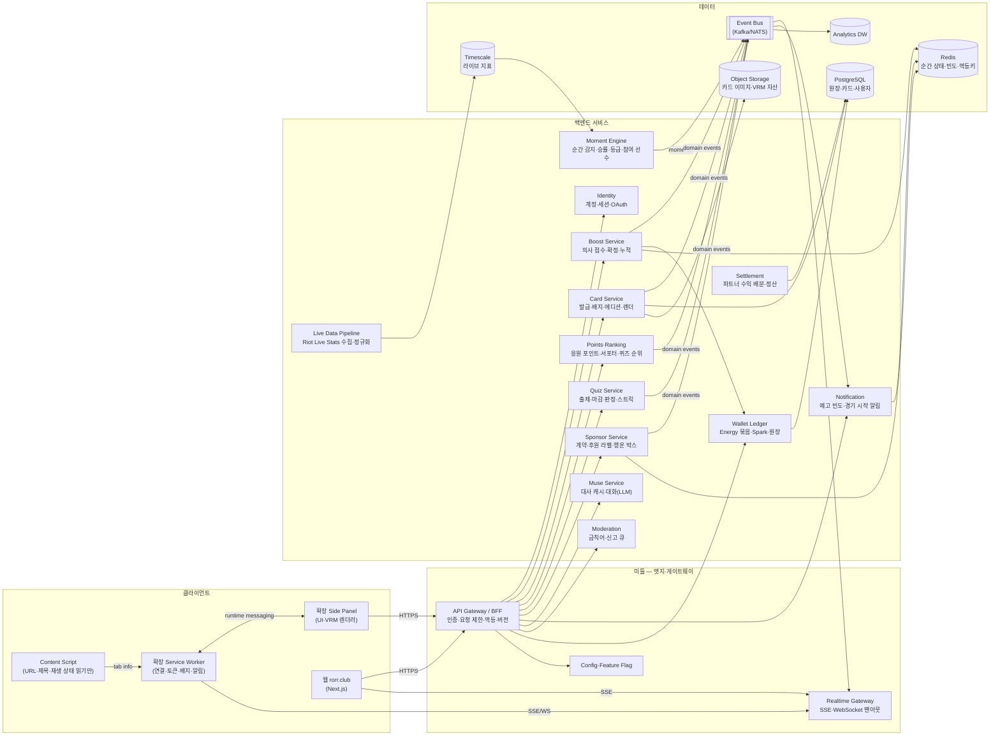
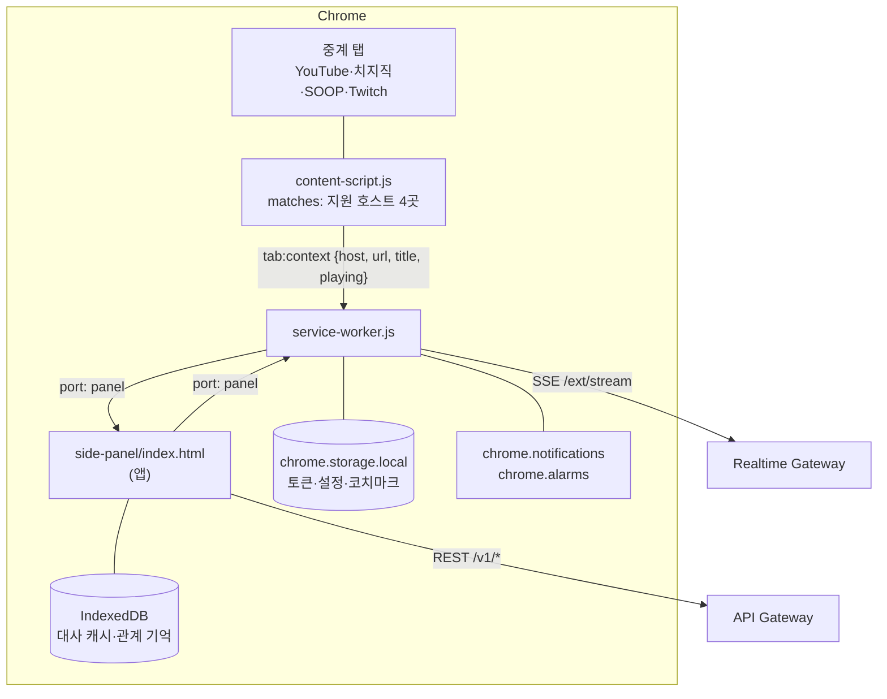

# 07. 시스템 구성 — 프론트엔드·미들·백엔드

- 작성일: 2026-10-17 · 근거: `docs/04-architecture.md`, 웹 `rorr-hero/handoff/01-architecture-map.md`, 정책 v1.3
- 원칙: **웹과 같은 DB·API**(서비스 플로우 v2). 확장 전용은 ① 중계 매칭 ② 순간 스트림 ③ Muse 대사 3종(OI-20)
- 판정은 전부 서버. 확장은 신뢰 경계 밖(위변조 전제)

---

## 1. 전체 구성도

## 2. 계층별 책임

| 계층 | 구성 | 책임 | 하지 않는 것 |
|---|---|---|---|
| 프론트엔드(확장) | Side Panel 앱, Service Worker, Content Script | 화면·상호작용·연출, 순간 스트림 수신, 두 번 누르기 대기, 서버 응답 표시, 로컬 설정 | 잔액 계산·차감, 카드·배지 판정, 행운 박스 난수, 순간 등급 판정 |
| 프론트엔드(웹) | Next.js | 같은 API로 웹 화면, 충전·환불·광고 월·알림함 | 확장 전용 3종 |
| 미들 | API Gateway/BFF, Realtime Gateway, Config | 인증 토큰 검증, 요청 제한, `Idempotency-Key` 보관, API 버전, 실시간 팬아웃·재연결 복구, 기능 플래그·설정 변수 배포 | 도메인 판정 |
| 백엔드 | 도메인 서비스 13종 | 규칙 판정·원장·발급·집계·알림·정산 | 화면 문구 조합(문구 키만 반환) |
| 데이터 | PostgreSQL·Timescale·Redis·Event Bus·Object Storage·DW | 영속·실시간 상태·이벤트·분석 | — |

## 3. 확장 프로그램 내부 구조 (Manifest V3)

| 구성 | 파일(권장) | 역할 |
|---|---|---|
| Manifest | `manifest.json` | `side_panel.default_path`, 권한 `sidePanel storage identity notifications alarms`, host 권한: 지원 호스트 4곳 + `api.rorr.club`. `<all_urls>` 금지 |
| Service Worker | `sw/index.ts` | 탭 감지·중계 매칭 요청, 순간 스트림 연결(패널이 열려 있는 동안), 토큰 갱신, 아이콘 배지(패널 닫힘 시 큰 순간), 경기 시작 알림 |
| Content Script | `cs/watch.ts` | 지원 호스트에서 URL·제목·재생 상태만 읽어 SW로 전달. DOM 변경 금지 |
| Side Panel 앱 | `panel/` | UI 전체(화면 명세 02). SW와 `chrome.runtime.connect` 포트로 통신 |
| 렌더러 | `panel/renderer/` | VRM 3D(Three.js + @pixiv/three-vrm), `CompanionRenderer` 인터페이스. 모델·애니메이션은 패키지 동봉(원격 코드 금지), 저사양 폴백 정지 이미지 |

### 3-1. SW ↔ 패널 메시지

| 방향 | type | payload | 설명 |
|---|---|---|---|
| SW → 패널 | `match.resolved` | `{match_id, host, offset_ms}` | 중계 매칭 완료 |
| SW → 패널 | `stream.event` | 실시간 이벤트 원문(09 §5) | 순간·스코어·퀴즈·Boost 확정 |
| SW → 패널 | `stream.status` | `{state: connecting/open/retrying/offline, since}` | 연결 상태 표시 |
| SW → 패널 | `auth.changed` | `{signed_in, user_id}` | 로그인·로그아웃 |
| 패널 → SW | `panel.opened` / `panel.closed` | — | 스트림 연결 유지·해제, 아이콘 배지 초기화 |
| 패널 → SW | `calibrate.offset` | `{delta_ms}` | 지연 1탭 보정 |
| 패널 → SW | `auth.request` | — | `launchWebAuthFlow` 시작 |

- SW는 비활성 시 종료될 수 있음 → 패널이 열려 있는 동안 포트 연결로 유지, 끊기면 패널이 재연결 요청. 마지막 이벤트 ID(`Last-Event-ID`)로 누락분 복구

## 4. 미들 계층 상세

| 기능 | 규칙 |
|---|---|
| 인증 | 웹 세션과 같은 계정. 확장은 OAuth 2.0 PKCE(`launchWebAuthFlow`) → 액세스 토큰 15분 + 갱신 토큰 30일(SW 보관). 헤더 `Authorization: Bearer` |
| 클라이언트 식별 | `X-RORR-Client: ext/2.0.0` · `web/…` — Boost 기록의 채널(`web/ext`) |
| 멱등 | 쓰기 API 전부 `Idempotency-Key`(UUID v4) 필수. 24시간 보관, 같은 키 재요청은 첫 응답 그대로 반환 |
| 요청 제한 | 사용자당 Boost 10회/10초, 행운 박스 열기 순간당 1회(서버 판정), 퀴즈 답 문항당 1회. 초과 `429` + `Retry-After` |
| 버전 | 경로 `/v1/`. 하위 호환 깨지면 `/v2/`. 확장은 최소 지원 버전을 `/v1/config`로 받음(구버전 강제 업데이트 안내) |
| 설정·플래그 | `GET /v1/config` — 정책 변수(웹 handoff 06 §6과 같은 이름) + 기능 플래그. 5분 캐시 |
| 실시간 | SSE 기본, 프록시 환경 대비 WebSocket 대체. 하트비트 15초, 재연결 지수 백오프(1→2→4→8→15초 상한) |
| 관측 | 요청 ID `X-Request-Id` 전달, 서비스 간 추적(OpenTelemetry) |

## 5. 백엔드 서비스 책임

| 서비스 | 주요 책임 | 소유 테이블(10-data-schema) | 발행 이벤트 |
|---|---|---|---|
| Identity | 계정·OAuth·미성년 여부·동의 | `users`, `user_consents` | `user.*` |
| Live Data Pipeline | Riot Live Stats 1초 수집, 정규화 | `matches`, `games`, Timescale `live_frames` | `match.*` |
| Broadcast(v46, Live Data 안 모듈) | 공식 채널 등록부, 경기×채널 매칭, 채널 기본 지연 측정·사용자 보고 집계(16 §3) | `channels`, `broadcasts`, `broadcast_offset_measurements`, `stream_offset_reports` | `broadcast.offset` |
| Moment Engine | 순간 후보 감지, 승률 변화, 등급(실버·골드·홀로), 참여 선수·기여도 1위, 예고·발생·종료 | `moments`, `moment_participants` | `moment.upcoming/started/resolved/closed` |
| Boost Service | 의사 접수, 확정(OI-13 모드), 누적·배지 재계산 위임 | `boosts` | `boost.accepted/settled/rejected` |
| Wallet Ledger | Energy 묶음(유료·보너스), Spark, 원장 append-only, 묶음 사용 기록 | `energy_lots`, `spark_lots`, `wallet_ledger`, `boost_lot_usage` | `wallet.changed` |
| Card Service | 순간당 1장 멱등 발급, 재화별 누적·배지, 에디션 판정, 카드 주인공 결정, 카드 이미지 | `cards`, `card_currency_totals` | `card.issued/badge_up` |
| Points·Ranking | 응원 포인트(순간당 1회), 연속 응원, 서포터 순위, 퀴즈 순위 분리 집계 | `cheer_points`, `rank_snapshots` | `points.awarded` |
| Quiz Service | 출제·마감(서버 시각 + 지연 여유), 판정, 스트릭, 주간 상금 | `quiz_questions`, `quiz_answers`, `quiz_weekly` | `quiz.*` |
| Sponsor Service | 계약·범위, 후원 라벨 노출 조건, 행운 박스 판정·총량·홀드아웃 | `sponsors`, `sponsor_contracts`, `sponsor_box_opens` | `sponsor.box_opened` |
| Notification | 예고 빈도 상한, 경기 시작 알림, 알림 노출 기록 | `notification_prefs`, `headsup_impressions` | — |
| Muse Service | 세그먼트 대사 캐시, 1:1 대화(LLM), 라이브 맥락 첨부 | `muse_lines` | — |
| Moderation | 응원 메시지 금칙어·신고 큐 | `cheer_messages`, `reports` | `message.*` |
| Settlement | 파트너 수익 배분(정가 환산·유료분만), 월 정산·시즌 누적 공개값 | `settlements` | — |

## 6. 비기능 요구

| 항목 | 목표 |
|---|---|
| 순간 예고 지연 | 파이프라인 감지 → 패널 표시 p95 1.5초 이내(중계 지연 보정 전) |
| Boost 응답 | `POST /v1/boosts` p95 300ms(확정 모드 `immediate`) |
| 동시 접속 | 결승 기준 순간당 동시 Boost 5만 건/분 처리(큐 기반 순간 누적) |
| 가용성 | 경기 시간대 99.9% |
| 일관성 | 원장은 강한 일관성(단일 트랜잭션), 순위·함께 Boost 수는 최종 일관성(5초 이내) |
| 보안 | 확장은 비밀 값 보관 금지(API 키 없음), 토큰만. 모든 판정 서버 |
| 개인정보 | 응원 메시지·관계 기억 외 개인 데이터 최소. 미성년 노출 기본 끔(정책 §7) |
