# 08. 흐름도

- 작성일: 2026-10-17 · 기준: 목업 v46, 정책 v1.3 · 표기: Mermaid(GitHub에서 그림으로 표시)
- 사용자 흐름(F-), 시퀀스(Q-), 상태(S-)로 구분. 화면 번호는 02-screen-spec, API는 09-api-spec, 이벤트는 09 §5

---

## 목록

| 번호 | 흐름 | 종류 |
|---|---|---|
| F-1 | 설치 → 첫 실행 → 로그인 | 사용자 흐름 |
| F-2 | 중계 매칭 → 시청 상태 확인(v46) | 사용자 흐름 |
| W-1 | 시청 상태 4종(v46) | 상태 |
| Q-5 | 채널 기본 지연 측정·갱신(v46) | 시퀀스 |
| S-1 | 패널 화면 상태(S0~S5) | 상태 |
| Q-1 | 큰 순간 예고 → Boost → 카드 공개 | 시퀀스 |
| S-2 | 두 번 누르기 | 상태 |
| F-3 | 재Boost 누적·배지 상승 | 사용자 흐름 |
| F-4 | 카드 주인공 결정 [논의 중] | 판정 |
| F-5 | 내 선수 묻기 | 사용자 흐름 |
| Q-2 | 스폰서 행운 박스 [논의 중] | 시퀀스 |
| F-6 | 잔액 부족 → 충전 → 복귀 | 사용자 흐름 |
| Q-3 | 퀴즈 출제 → 답 → 판정 | 시퀀스 |
| F-7 | 경기 시작 알림(패널 닫힘) | 사용자 흐름 |
| F-8 | 비제휴 팀 경기 | 분기 |
| S-3 | 실시간 연결·재연결 | 상태 |
| Q-4 | Boost 확정 방식(OI-13 두 방식) | 시퀀스 |

---

## F-1. 설치 → 첫 실행 → 로그인

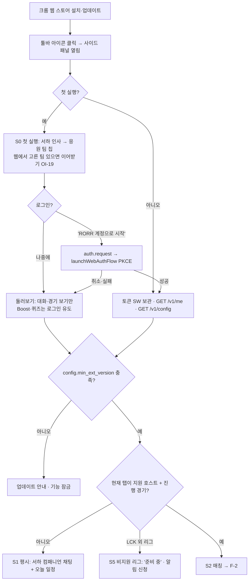

- 둘러보기에서 Boost를 누르면 시트 대신 로그인 안내(잔액 0 표시 금지)
- 미성년 계정(`users.is_minor`): 행운 박스·충전 진입 미노출, Energy Boost 불가(정책 §7)

## F-2. 중계 매칭 → 시청 상태 확인 (v46)

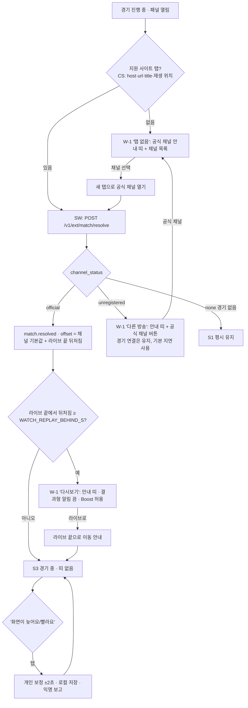

- 판정 입력은 Content Script가 읽는 **호스트·URL·제목·재생 상태·라이브 끝까지 거리**뿐(`video.seekable.end − currentTime`). 영상 화면은 읽지 않음, 권한 추가 없음
- 초기 등록 범위: **공식 채널만**(`channels.kind=official`). 코스트리밍은 2단계에서 같은 구조로 등록 — 그전까지 코스트리밍은 '다른 방송'으로 판정
- 다시보기·다른 방송에서도 **Boost는 막지 않음**(안내만, 2026-10-17 결정)
- 표시 시점(docs/04 §4): **예고형**(`moment.upcoming`, `quiz.opened`)은 받는 즉시, **결과형**(`moment.resolved`, `match.state` 스코어·골드, `quiz.resolved`, 킬·오브젝트 대사)은 개인 지연 도달 후. 다시보기 상태에서는 결과형 알림 표시 안 함
- 중계 URL은 매칭 후 서버에서 폐기(docs/04 §6)

## W-1. 시청 상태 (v46)

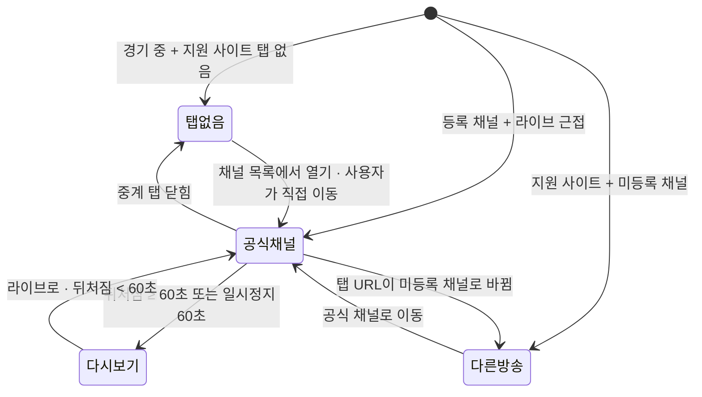

| 상태 | 띠 문구(제목 / 보조 / 버튼) | 결과형 알림 | Boost |
|---|---|---|---|
| 공식 채널 | (띠 없음) | 개인 지연 후 표시 | 가능 |
| 탭 없음 | '지금 T1 vs GEN 경기 중이에요' / '공식 채널에서 보면 서하가 화면에 맞춰요' / '채널 보기' | 채널 기본 지연 후 표시 | 가능 |
| 다른 방송 | '이 방송은 경기와 맞춰지지 않아요' / '알림이 화면과 어긋날 수 있어요' / '공식 채널' | 채널 기본 지연 후 표시 | 가능 |
| 다시보기 | '라이브보다 N분 늦게 보고 있어요' / '스포일러가 없도록 결과 알림은 꺼 둘게요' / '라이브로' | **표시 안 함** | 가능(안내만) |

- 상태 전환은 3초 이상 유지될 때만 반영(탭 이동·버퍼링으로 띠가 깜박이지 않게)
- 사용자가 띠를 닫으면 그 경기 동안 같은 상태로는 다시 띄우지 않음(상태가 바뀌면 다시 표시)

## Q-5. 채널 기본 지연 측정·갱신 (v46)

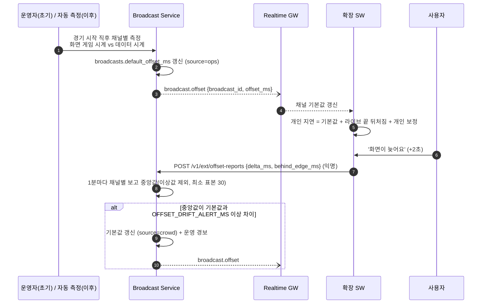

## S-1. 패널 화면 상태 (이름은 docs/03-ux-flow §2와 동일)

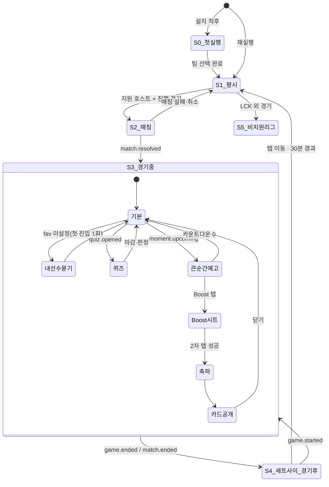

- 화면 매핑(02-screen-spec): S1·S2 = 경기 전 대화(§2), S3 = 경기 중(§1 골격, §3~§11), S4 = 경기 요약(§12)
- 경기 시작 전 대기(매칭됨·시작 전)는 S3 진입 전 S2 안의 하위 상태로 처리 — 대화 화면 유지 + 스코어 칩 '곧 시작'
- 퀴즈가 열린 상태에서 `moment.upcoming`이 오면 퀴즈를 먼저 마감(05 §6)

## Q-1. 큰 순간 예고 → Boost → 카드 공개

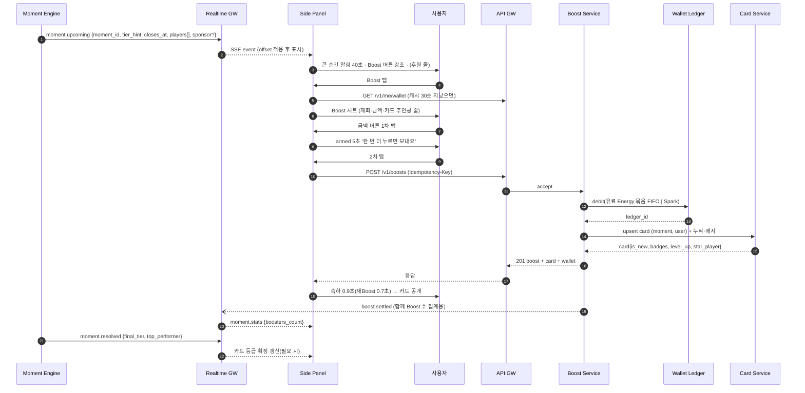

- 등급 확정 시점: 예고 단계 `tier_hint`, 종료 시 `final_tier`. 카드 테두리는 `final_tier` 기준(목업은 예고 등급으로 바로 표시 — 구현 시 확정 전엔 '등급 확정 중' 표시 없이 hint 사용, 확정 값이 다르면 카드에서 조용히 갱신)
- 실패(4xx/5xx/시간 초과 8초): 시트 유지 · '보내지 못했어요. 차감되지 않았어요.' · 같은 키로 재시도 버튼

## S-2. 두 번 누르기

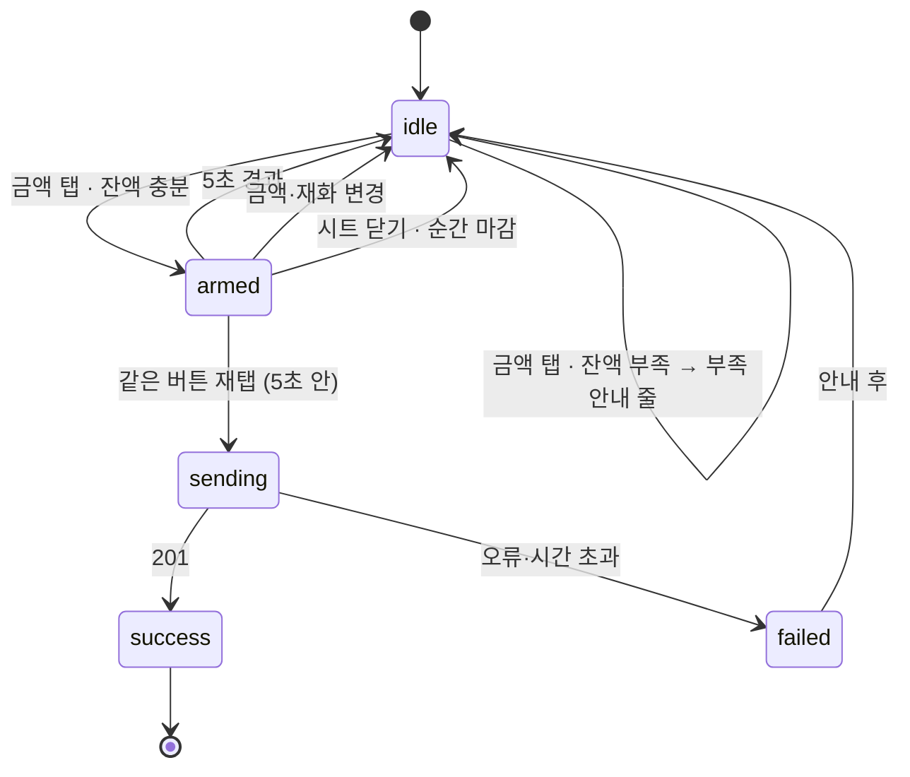

- armed 표시: 버튼 테두리 링 5초 감소(`--cfp`), 문구 '한 번 더 누르면 보내요', 스크린리더 알림 1회
- sending 중 버튼 비활성·회전 표시. 중복 탭 무시

## F-3. 재Boost 누적·배지 상승

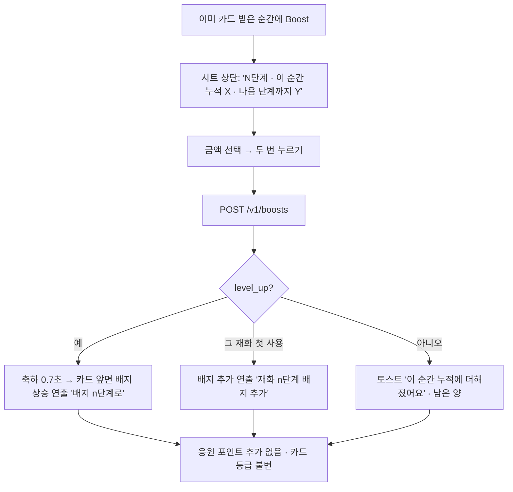

## F-4. 카드 주인공 결정 [논의 중]

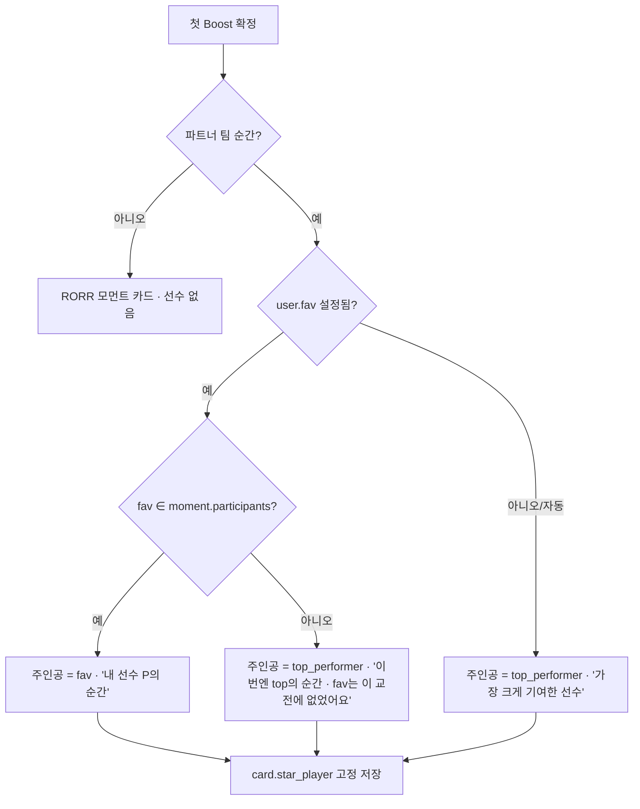

- 판정은 Card Service. 시트에는 예상 주인공을 미리 표시(`GET /v1/moments/{id}`의 `star_preview`)

## F-5. 내 선수 묻기

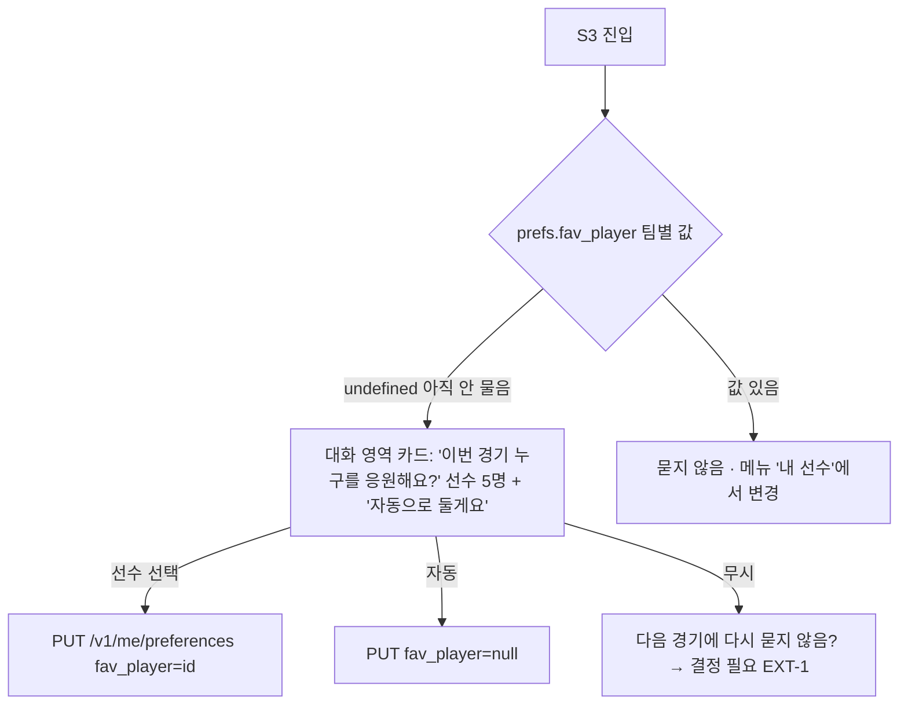

- EXT-1(미결): '한 번만 묻기(기본값)' vs '경기마다 묻기'. 목업은 한 번만 묻기

## Q-2. 스폰서 행운 박스 [논의 중]

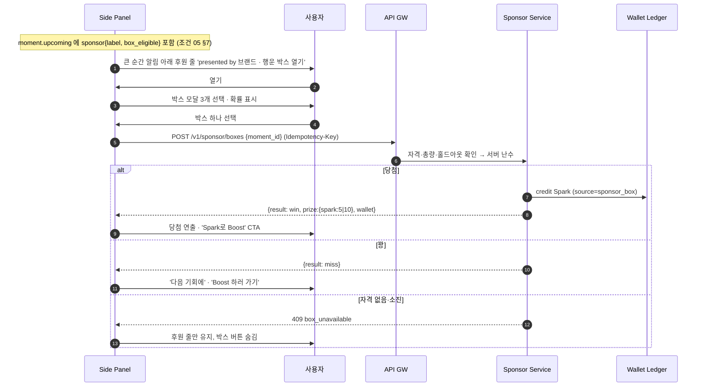

- 클라이언트는 박스 선택 위치를 보내지 않음(결과와 무관)
- 같은 순간 재요청은 첫 결과 그대로(멱등 + 순간당 1회)

## F-6. 잔액 부족 → 충전 → 복귀

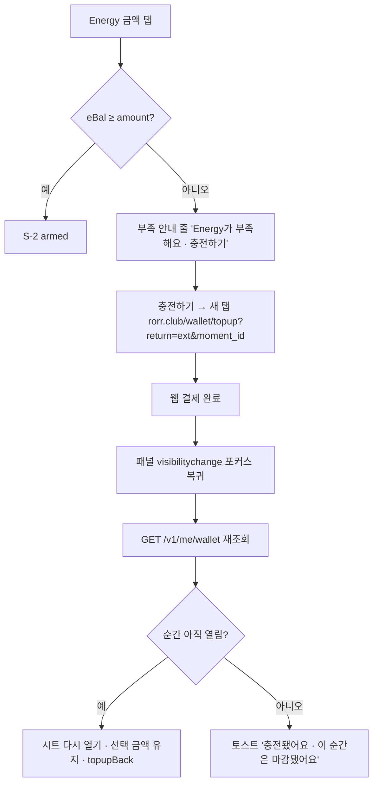

- 확장 안에서 결제하지 않음(웹 결제 화면으로 이동). Spark 부족 시 '광고 보고 Spark 받기'는 웹 광고 월로 이동

## Q-3. 퀴즈

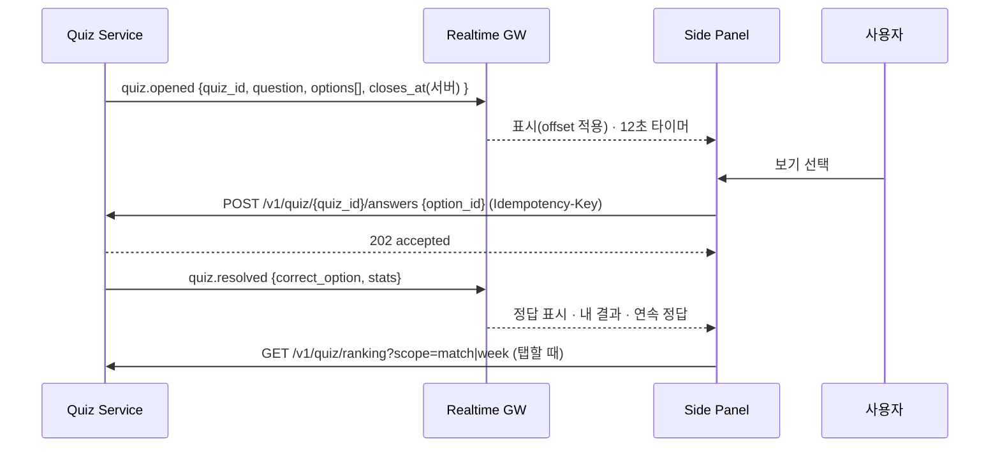

- 마감 판정은 서버 시각 기준 + 호스트 지연 여유(`QUIZ_GRACE_MS`). 클라이언트 타이머는 표시용

## F-7. 경기 시작 알림 (패널 닫힘)

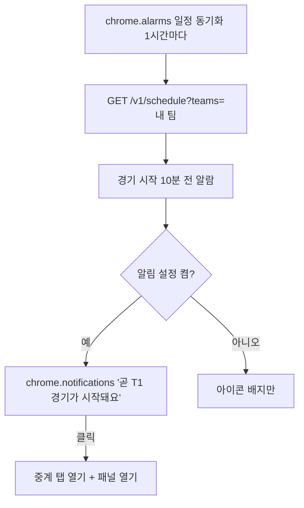

- 패널이 닫힌 상태의 큰 순간: 아이콘 배지 점만(알림 팝업 금지 — 빈도 정책)

## F-8. 비제휴 팀 경기

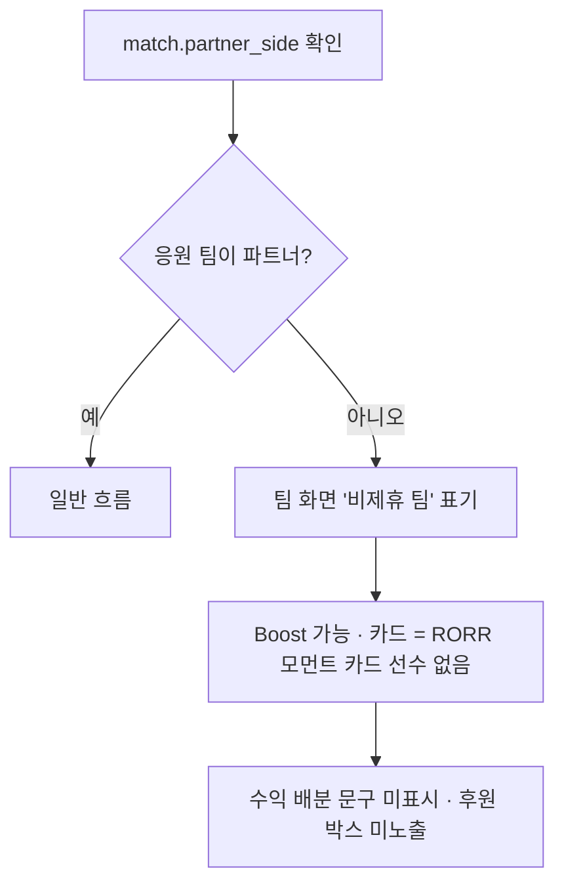

## S-3. 실시간 연결

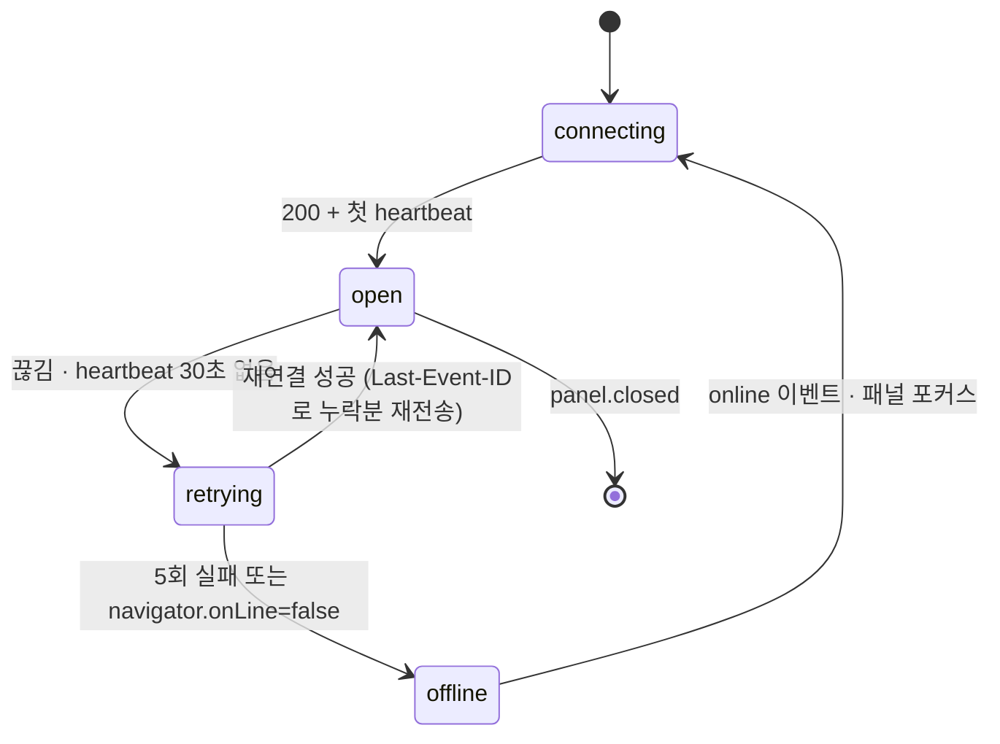

- `retrying` 3초 이상: 상단 얇은 띠 '연결 중…'. `offline`: Boost·퀴즈 버튼 비활성 + '연결이 끊겼어요'
- 재연결 후 놓친 순간이 이미 마감됐으면 표시하지 않음(경기 기록에만)

## Q-4. Boost 확정 방식 (OI-13 미결 — 두 방식 모두 지원)

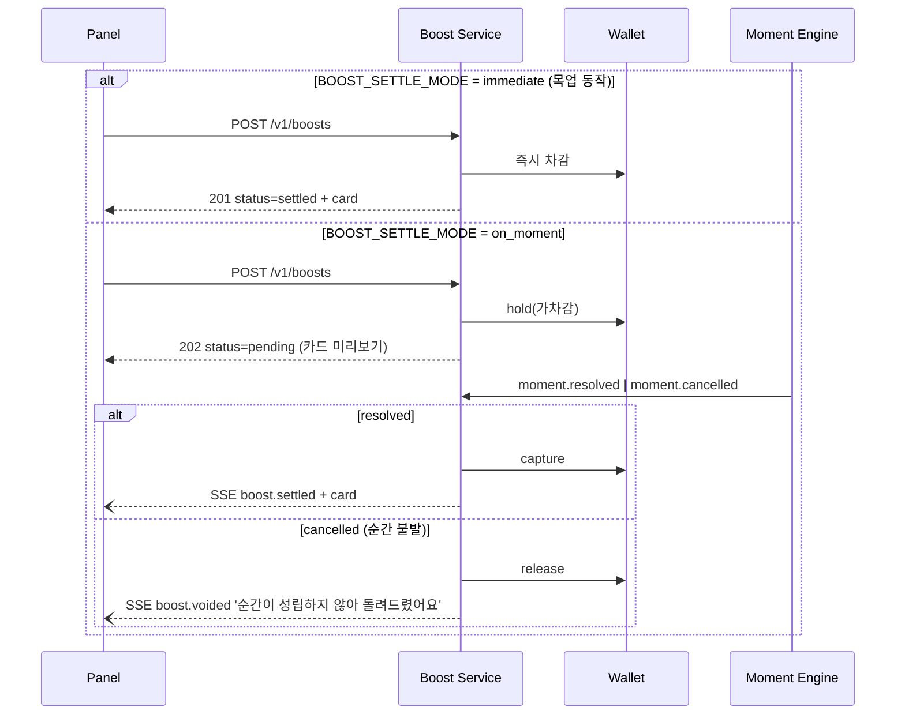

- 모드는 `GET /v1/config`의 `BOOST_SETTLE_MODE`. 클라이언트는 `status`로 분기(목업 화면은 `settled` 기준)
