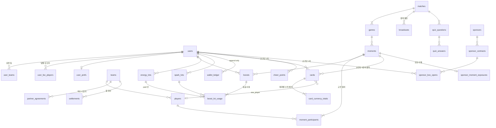

# 10. 데이터 스키마

- 작성일: 2026-10-17 · DDL: `schema/schema.sql`(PostgreSQL 16, 빈 DB 적용 확인 2026-10-17 — 테이블 43개·뷰 1개)
- 지갑·환불 테이블은 웹 `docs/specs/refund.md`와 **이름·컬럼 동일**. 이 패키지에서 더한 컬럼은 DDL에 `-- (ext)` 표시
- 실시간 프레임(Live Stats 1초 단위)은 TimescaleDB `live_frames`(별도, 파이프라인 소유)로 이 DDL에서 제외

---

## 1. 관계도 (핵심)

## 2. 테이블 요약

| 영역 | 테이블 | 핵심 제약 | 소유 서비스(07 §5) |
|---|---|---|---|
| 계정 | `users`, `user_consents`, `oauth_sessions` | `is_minor` 서버 계산 | Identity |
| 응원 설정 | `user_teams`, `user_prefs`, `user_fav_players` | 내 선수: 행 없음 = 안 물음, `player_id NULL` = 자동 | Identity |
| 팀 | `teams`, `players`, `partner_agreements`, 뷰 `partner_teams` | `share_bp` 화면 노출 금지 | Admin |
| 경기 | `matches`, `games`, `match_lineups`, `broadcasts`, `stream_offset_reports` | 중계 호스트 4곳 | Live Data |
| 순간 | `moments`, `moment_participants` | `team_id` = 승리확률이 움직인 쪽 = 적립 팀 | Moment Engine |
| 지갑 | `energy_lots`, `spark_lots`, `wallet_ledger` | 원장 append-only, 묶음 FIFO 인덱스 | Wallet Ledger |
| Boost | `boosts`, `boost_lot_usage` | `UNIQUE(user_id, idempotency_key)` | Boost |
| 카드 | `cards`, `card_currency_totals` | `UNIQUE(user_id, moment_id)`, `UNIQUE(moment_id, serial_no)`, 배지 0~3 | Card |
| 포인트 | `cheer_points`, `cheer_streaks`, `rank_snapshots` | `UNIQUE(user_id, moment_id)` — 재Boost 포인트 없음 | Points |
| 퀴즈 | `quiz_questions`, `quiz_answers`, `quiz_weekly` | 문항당 1답 PK | Quiz |
| 스폰서 | `sponsors`, `sponsor_contracts`, `sponsor_moment_exposures`, `sponsor_box_opens`, `sponsor_holdout` | 박스 `UNIQUE(user_id, moment_id)`, 난수 기록 | Sponsor |
| 알림 | `headsup_impressions` | 빈도 상한 판정 | Notification |
| 메시지 | `cheer_messages`, `reports` | 60자 | Moderation |
| Muse | `muse_lines` | `version` 단위 캐시 | Muse |
| 환불·정산 | `refunds`, `settlements` | 웹 refund.md | Settlement |
| 운영 | `config_values`, `idempotency_keys`, `disclosures` | 키 24시간(Redis 대안) | Gateway·Admin |

## 3. 규칙을 데이터로 지키는 방법

| 규칙(정책) | 데이터 장치 |
|---|---|
| 카드 순간당 1장(§4) | `cards UNIQUE(user_id, moment_id)` + `INSERT … ON CONFLICT DO NOTHING` |
| 재Boost는 배지만(§4 개정) | `card_currency_totals.total += amount` 후 단계 재계산. `cards.tier` 미변경 |
| 응원 포인트 순간당 1회(§5-3) | `cheer_points UNIQUE(user_id, moment_id)` |
| 연속 응원 경기당 1회(§5-3) | `cheer_streaks.last_match_id`와 비교해 경기 첫 Boost에서만 갱신 |
| Boost는 유료 Energy만(v1.3 §1-1) | 차감 쿼리에 `kind='paid'` 고정. `boost_lot_usage`에 bonus 묶음 ID가 들어가면 트리거로 거부(권장) |
| 팀 배분 = 유료·정가 기준(v1.3 §8) | `settlements.base_krw = Σ qty × list_unit_price_krw` (kind=paid) |
| 원장 불변 | `wallet_ledger`에 UPDATE·DELETE 권한 회수, 정정은 `adjust` 행 추가 |
| 카드 주인공 고정(§4-1 초안) | `cards.star_player_id`·`star_reason` 발급 시 기록, 이후 갱신 금지 |
| 행운 박스 순간당 1회·서버 난수(§6-1) | `sponsor_box_opens UNIQUE(user_id, moment_id)` + `rng_seed_ref` 감사 기록 |
| 미성년 제한(§7) | `users.is_minor` → Boost(Energy)·박스·충전 API에서 거부 |

## 4. 웹 refund.md와의 차이 (웹 문서 갱신 필요)

| 항목 | refund.md | 이 스키마 | 근거 |
|---|---|---|---|
| Boost 차감 순서 | 보너스 먼저 → 유료 | **유료만**(보너스는 RORR 장식 구매에만) | 정책 v1.3 §1-1 안 C |
| 정산 기준 단가 | `unit_price_krw`(실결제) | `list_unit_price_krw`(정가) 추가 | 정책 v1.3 §8 '할인 전 정가 환산액' |
| 테스트 케이스 4·9 | 보너스 20 먼저 소진 / Boost 50 = 보너스 20 + 유료 30 | 성립하지 않음(보너스는 Boost 불가) | v1.3 |
| Spark 묶음 | 정의 없음 | `spark_lots` 추가 | 확장 행운 박스·퀴즈 상금 출처 추적 |
| 원장 사유 | 7종 | `ad_reward, quiz_prize, sponsor_box, deco_purchase, boost_hold, boost_release` 추가 | Spark·확정 대기 모드 |

## 5. 보관·개인정보

| 데이터 | 보관 | 비고 |
|---|---|---|
| 원장·Boost·정산 | 5년 이상(전자상거래법·세무) | 탈퇴 후에도 익명화 보관 |
| 응원 메시지 | 경기 후 1년 | 신고 처리분은 처리 기록 보관 |
| 지연 보정 보고 | 90일 | 사용자 ID 미저장 |
| 측정 이벤트 | DW 2년 | `user_id`는 가명 키로 변환 |
| 관계 기억(Muse) | 로컬 IndexedDB만 | 서버 미저장(07 §6) |
