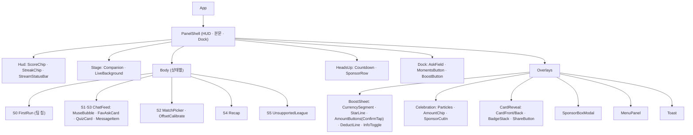

# 12. 프론트엔드 구현 가이드 (확장 프로그램)

- 작성일: 2026-10-17 · 대상: Chrome Manifest V3 확장 v2.0
- 권장 스택(웹과 공유 쉬운 쪽): TypeScript · Vite(+ CRXJS) · React 18 · Zustand(상태) · CSS Modules + `css/tokens.css` · Three.js + @pixiv/three-vrm · Vitest · Playwright
- 목업 코드는 **참조용**(단일 HTML·IIFE·전역 상태). 구조·클래스명을 옮기지 말고 화면·동작·값만 옮길 것(웹 handoff 09 §4와 같은 판단)

---

## 1. 저장소 구조 (권장)

```
rorr-extension-app/
├─ manifest.config.ts           # MV3 매니페스트(07 §3 권한)
├─ src/
│  ├─ sw/                       # Service Worker
│  │  ├─ index.ts               # 진입: 메시지 라우터
│  │  ├─ auth.ts                # PKCE·토큰 갱신(chrome.identity)
│  │  ├─ match.ts               # 탭 감지 → /ext/match/resolve
│  │  ├─ stream.ts              # SSE 연결·재연결·Last-Event-ID
│  │  ├─ badge.ts               # 아이콘 배지(패널 닫힘)
│  │  └─ alarms.ts              # 경기 시작 알림
│  ├─ cs/watch.ts               # Content Script(읽기 전용): host·URL·제목·재생 상태·라이브 끝까지 거리(2초 주기)
│  ├─ panel/
│  │  ├─ main.tsx
│  │  ├─ app/                   # 화면 상태 S0~S5 라우팅(08 S-1)
│  │  ├─ features/
│  │  │  ├─ live/               # HUD·독·대화
│  │  │  ├─ headsup/            # 큰 순간 알림·후원 줄
│  │  │  ├─ boost/              # 시트·두 번 누르기·축하
│  │  │  ├─ card/               # 카드 공개·뒤집기·카드함
│  │  │  ├─ quiz/
│  │  │  ├─ sponsor-box/        # [논의 중] 플래그 뒤
│  │  │  ├─ moments/            # 오늘의 모먼트·경기 후 요약
│  │  │  ├─ team/               # 팀·팬덤·순위
│  │  │  └─ menu/               # 내 선수·알림 수준·언어·로그아웃
│  │  ├─ companion/             # CompanionRenderer(VRM / 정지 이미지 폴백)
│  │  ├─ ui/                    # Button, Sheet, Toast, Segment, Badge, InfoToggle …(04-components)
│  │  ├─ store/                 # Zustand 슬라이스(§3)
│  │  ├─ api/                   # openapi.yaml 생성 클라이언트 + 멱등 키
│  │  ├─ i18n/                  # ko.json·en.json·조사 함수(05 §10)
│  │  └─ telemetry/             # 이벤트 큐(14)
│  └─ shared/                   # SW·패널 공용 타입(메시지·이벤트)
├─ public/models/               # VRM·애니메이션(동봉, 원격 로드 금지)
└─ tests/                       # unit · e2e(Playwright로 패널 페이지 직접 열기)
```

- 웹과 공유 가능: `api/`(생성 클라이언트), `i18n` 문구 원본, `tokens.css`, 조사 함수, 도메인 타입 → 별도 패키지 `@rorr/shared` 권장(웹 OI-15 저장소 결정과 함께)

## 2. 컴포넌트 트리



- 레이어 순서는 토큰 `--z-*`만 사용(03 §3). 오버레이는 한 번에 하나(시트 → 축하 → 카드 순서 교체)

## 3. 상태 저장소

| 슬라이스 | 내용 | 출처 | 갱신 |
|---|---|---|---|
| `session` | `signedIn, user, isMinor, config, flags` | `/me`, `/config` | 로그인·`config.changed` |
| `match` | `matchId, status, score, clock, lineups, partnerSide, offsetMs` | `match.resolved`, `/matches/{id}`, `match.state` | SSE |
| `moments` | `byId`, `activeId`, `headsUp{momentId, closesAt, sponsor}` | `moment.*` | SSE + REST 재조회 |
| `wallet` | `paid, bonus, spark` | `/me/wallet`, Boost 응답, `wallet.changed` | 서버 값만(낙관적 차감 금지) |
| `boost` | `sheetOpen, currency, amount, phase(idle/armed/sending/failed), armedUntil, idemKey` | 로컬 | 08 S-2 |
| `cards` | `byMoment`, `reveal{card, mode: new/levelup/add/same}` | Boost 응답, `card.updated` | — |
| `quiz` | `current, myAnswer, streak` | `quiz.*` | SSE |
| `prefs` | `favPlayers, alertLevel, lang` | `/me/preferences` | 메뉴 변경 즉시 PATCH |
| `ui` | `coachmarksSeen, toast, reducedMotion` | `chrome.storage.local` | — |
| `conn` | `streamState, since` | SW `stream.status` | — |
| `watch`(v46) | `state(none/official/other/replay), broadcastId, channelOffsetMs, behindEdgeMs, nudgeMs, dismissed` | CS `tab:context`, `/ext/match/resolve`, `broadcast.offset` | 상태 3초 유지 후 반영, `nudgeMs`는 `chrome.storage.local`(경기·채널별) |

- `idemKey`: 2차 탭 순간 생성, 실패 후 재시도 버튼은 **같은 키** 사용, 금액·재화가 바뀌면 새 키
- 표시 시각 버퍼: 결과형 이벤트(`moment.resolved`·`match.state`·`quiz.resolved`)는 `server_ts + offsetMs` 도달 시 반영(스포일러 방지), 예고형은 즉시. 버퍼 상한 120초

## 4. 핵심 로직 의사 코드

```ts
// 두 번 누르기 (05 §5 / 08 S-2)
function onAmountTap(amount: number) {
  const s = boost.get();
  if (wallet.available(s.currency) < amount) return boost.showInsufficient();
  if (s.phase === 'armed' && s.amount === amount && Date.now() < s.armedUntil) return send();
  boost.arm(amount, Date.now() + config.BOOST_CONFIRM_WINDOW_MS);   // 링 시작, 타이머로 idle 복귀
}

async function send() {
  const { currency, amount } = boost.get();
  const key = boost.ensureIdemKey();
  boost.set({ phase: 'sending' });
  try {
    const r = await api.postBoost({ moment_id: moments.activeId, currency, amount }, key);
    wallet.setFromServer(r.wallet);
    cards.reveal(r.card);                        // mode = is_new ? 'new' : level_up ? 'levelup' : 'same'
    celebrate(r.card.tier, r.card.is_new ? 900 : 700);
    track('boost_confirm_ok', { currency, amount, is_new: r.card.is_new });
  } catch (e) {
    boost.set({ phase: 'failed' });
    toast(t(errorKey(e)));                       // '보내지 못했어요. 차감되지 않았어요.'
  }
}
```

```ts
// wallet.available: Energy는 유료만 (정책 v1.3 §1-1)
available = (c) => c === 'energy' ? state.paid : state.spark;
```

## 4-1. 시청 상태·개인 지연 (v46)

```ts
// CS → SW 2초마다 (지원 사이트 4곳에서만)
{ host, url, title, playing, behindEdgeMs: video ? (video.seekable.end(video.seekable.length-1) - video.currentTime) * 1000 : null }

// 패널
const personalOffset = watch.channelOffsetMs + (watch.behindEdgeMs ?? 0) + watch.nudgeMs;
const state = !tab ? 'none'
  : resolve.channel_status !== 'official' ? 'other'
  : (watch.behindEdgeMs ?? 0) >= config.WATCH_REPLAY_BEHIND_S * 1000 ? 'replay' : 'official';
// state === 'replay' → 결과형 이벤트 표시 안 함(버퍼에서 폐기), 예고형·Boost는 그대로
```

- `seekable`이 비어 있거나 라이브가 아니면 `behindEdgeMs = null` → 채널 기본값만 사용
- 탭 이동·버퍼링 깜박임 방지: 같은 상태가 `WATCH_STATE_HOLD_MS` 유지될 때만 띠 전환

## 5. 메시징·수명 주기

- 패널 열림: `chrome.runtime.connect({name:'panel'})` → SW가 스트림 연결 유지. 닫힘(`port.onDisconnect`) → SW가 스트림 종료, 경량 폴링 + 아이콘 배지
- SW 종료 대비: 상태는 SW 메모리에 두지 않음. 토큰·`Last-Event-ID`·`offset_ms`는 `chrome.storage.session`/`local`
- 패널 포커스 복귀(`visibilitychange`): `/me/wallet` 재조회(충전 복귀 08 F-6), 스트림 상태 확인
- 다중 탭: 패널은 창 단위. 다른 창에서 같은 경기를 열면 각 패널이 각자 연결(SW가 경기별 연결 공유)

## 6. 성능 예산

| 항목 | 예산 |
|---|---|
| 패널 첫 표시(캐시된 상태) | 800ms 이내 |
| JS 번들(VRM 제외) | 250KB gzip |
| VRM 모델 | 8MB 이하, 텍스처 1024px(웹 OI-23 확정값 우선) |
| 렌더 | 30fps 상한, 패널 숨김 시 렌더 정지(`document.hidden`), 저사양(GPU 없음·배터리 절약) → 정지 이미지 |
| 축하 입자 | DOM 40개 이하, `transform`·`opacity`만 애니메이션 |
| 메모리 | 패널 150MB 이하(VRM 포함) |

### 6-1. 움직임 성능 규칙 (v47에서 목업에 적용)

| 규칙 | 이유 |
|---|---|
| 자주 바뀌는 값은 해당 요소의 `style.transform`에 직접 지정. 패널 최상위에 CSS 변수(`--px` 등)를 쓰지 않음 | 최상위 변수 변경은 패널 전체 스타일 재계산 |
| 움직임은 `transform`·`opacity`만. `width`·`left`·`height`·`margin`·`box-shadow` 애니메이션 금지(필요하면 미리 그린 레이어의 투명도) | 레이아웃·다시 그리기 비용 |
| 배경 장식 반복 애니메이션은 경기 중(S3)·패널 숨김(`document.hidden`) 동안 정지(`animation-play-state: paused`) | 중계 영상과 GPU 공유, 반투명 흐림 패널 위 반복 그리기 비용 |
| `transition: all` 금지, 속성 명시 | 의도하지 않은 속성까지 움직임 |
| 반복 애니메이션은 동작 줄이기에서 정지 또는 고정 표시 | 어지럼 위험 |

## 7. i18n

- 문구 원본 `i18n-ko.json`(영문 → 국문 536개 + 패턴 59개) → 키 체계로 변환: `area.element.state` (예: `boost.confirm.hint`, `card.star.fav_not_in_play`)
- 숫자·이름 뒤 조사: `josa(word, '이/가')` 함수(05 §10). 정규식 치환 방식 금지
- 서버 문구 키(`message_key`, `title_key`)도 같은 사전에서 찾음. 없으면 영어 → 키 이름 순으로 대체하고 측정 이벤트 `i18n_missing`

## 8. 테스트

| 종류 | 범위 | 도구 |
|---|---|---|
| 단위 | 두 번 누르기 타이머, 배지 단계 계산(표시용), 조사 함수, 이벤트 버퍼 | Vitest |
| 계약 | API 응답이 `openapi.yaml` 스키마와 일치 | 스키마 검증(Ajv) |
| 통합 | 모의 SSE 서버로 08 흐름 전체(큰 순간 → Boost → 카드, 재연결, 행운 박스) | Vitest + MSW |
| E2E | `chrome-extension://…/panel/index.html` 직접 열어 06-qa P0, 380·320px, 한·영 | Playwright(확장 로드) |
| 시각 | `screens/` 27장과 비교(허용 오차 1%) | Playwright 스냅샷 |
| 접근성 | axe 위반 0, 포커스 순서(04 §5) | @axe-core/playwright |

## 9. 배포·Muse 원가

- 기존 스토어 항목 `aeijenbcnhhmcgknnimiddbdgpndfcpn` 업데이트 배포(사용자 승계), 권한 추가 최소화 — 권한이 늘면 기존 사용자 재동의(docs/04 §7)
- 서하 반응 3층(docs/04 §5): 감탄·표정 = 규칙 대사 풀(가능하면 온디바이스 모델) · 순간 대사 = `/ext/muse/lines` 세그먼트 캐시 · 1:1 대화 = `/ext/muse/chat`(로그인 필수)

## 10. 보안

- 원격 코드 금지(MV3). 모델·스크립트 전부 패키지 동봉, `eval`·`new Function` 금지
- CSP 기본값 유지. 외부 이미지(로고·선수 사진)는 `api.rorr.club` CDN만
- Content Script는 DOM 읽기만, 페이지에 요소 삽입 금지(중계 사이트 약관·충돌)
- 토큰은 SW만 보관. 패널은 SW에 요청해 받은 단기 토큰으로 호출
