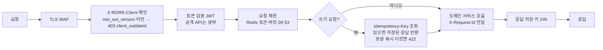

# 13. 미들·백엔드 구현 가이드

> **2026-10-17 통합 안내** — 공용 API·DB의 단일 기준은 `rorr-hero/handoff/api/openapi.yaml`·`db/schema.sql`(be35b45, 웹·확장 통합)입니다. 이 문서는 통합 전 확장 설계로 **참고용**이며, 차이·채택 근거와 확장 쪽 변경 사항(E-1~E-6)은 `rorr-hero/handoff/18-canonical-merge.md`를 보세요. 결정 사항 목록은 `rorr-hero/handoff/09-open-items.md` §0(BE-1은 '첫 경기 0'으로 결정).

- 작성일: 2026-10-17 · 구성 전제: 07-system-architecture(서비스 13종) · 데이터: 10-data-schema · API: 09-api-spec
- 참조 구현: `schema/boost_tx.sql`(Boost 확정 트랜잭션) + `schema/boost_tx_test.sql`(9개 시나리오, PostgreSQL 16에서 통과 2026-10-17)

---

## 1. 미들 계층 (API Gateway·BFF·Realtime Gateway)

### 1-1. 요청 처리 순서

| 항목 | 구현 |
|---|---|
| 멱등 저장 | Redis `idem:{user}:{key}` → `{status, body, body_hash}` TTL 24h. 처리 중 상태 `pending`(같은 키 동시 요청은 `409 in_progress` 대신 최대 3초 대기 후 결과 반환) |
| 요청 제한 | 사용자 ID 우선, 비로그인은 IP. 결승 등 대형 경기는 `config`로 한도 상향 가능 |
| 오류 표준화 | 서비스 예외 코드 → 09 §4 `code` + `message_key`. 스택·내부 메시지 노출 금지 |
| 버전 | `/v1` 고정. 필드 추가는 하위 호환, 삭제·의미 변경은 `/v2` |

### 1-2. Realtime Gateway

| 항목 | 구현 |
|---|---|
| 구독 | 연결 1개 = 경기 채널 `match:{id}` + 사용자 채널 `user:{id}`(로그인 시) |
| 팬아웃 | Event Bus(예: Kafka/NATS) `moment.*`·`quiz.*`·`match.*` → 경기 채널, `boost.*`·`wallet.changed`·`card.updated` → 사용자 채널 |
| 재전송 | 채널별 최근 5분 링 버퍼(Redis Stream). `Last-Event-ID` 이후 재전송, 범위 밖이면 `resync` |
| 묶음 | `moment.stats`는 2초 묶음, `match.state`는 5초 또는 변화 시 |
| 규모 | 결승 동시 연결 20만 가정, 게이트웨이 수평 확장, 경기 채널은 노드별 구독 |
| 스포일러 | 서버는 원시 시각만 보냄. 지연 반영은 클라이언트(`offset_ms`) |

## 2. Boost 처리 (Boost Service + Wallet Ledger + Card Service)

### 2-1. 트랜잭션 경계

- **한 DB 트랜잭션**: 멱등 확인 → 순간 상태 확인 → 묶음 차감(FIFO, `FOR UPDATE`) → 원장 기록 → 카드 upsert(순간당 1장) → 재화별 누적·배지 → 응원 포인트(순간당 1회)
- 트랜잭션 밖(커밋 후 비동기): `boost.settled` 이벤트 발행(Outbox 테이블 → Event Bus), `moments.boosters_count` 실시간 집계(Redis INCR, 5초마다 DB 반영), 순위 스냅샷
- 서비스 분리 시에도 위 범위는 **Wallet DB와 Card DB를 같은 PostgreSQL**에 두는 것을 권장(분산 트랜잭션 회피). 분리가 꼭 필요하면 Saga: 차감(hold) → 카드 → capture, 실패 시 release

### 2-2. 규칙 (참조 구현 `rorr_boost()`와 같아야 함)

| 순서 | 규칙 | 오류 |
|---|---|---|
| 1 | 같은 `(user, Idempotency-Key)` → 첫 결과 | — |
| 2 | 순간 `status ∈ (upcoming, open)` 그리고 `now ≤ closes_at`(+ 지연 여유 `BOOST_GRACE_MS` 검토) | `moment_closed` |
| 3 | `amount ∈ STEP_ENERGY / STEP_SPARK` | `amount_not_allowed` |
| 4 | 미성년 → Energy Boost 거부 | `minor_restricted` |
| 5 | Energy: `kind='paid'` 묶음만 만료 빠른 순. **보너스 묶음 사용 금지**(v1.3) | `insufficient_paid_energy` |
| 6 | Spark: `spark_lots` 만료 빠른 순 | `insufficient_spark` |
| 7 | 카드 없음 → 발급(등급 = `final_tier ?? tier_hint`, 에디션 = 파트너 여부, 주인공 F-4, 순번) | — |
| 8 | 재화별 `total += amount`, 단계 = `BADGE_*_L2/L3` 기준 | — |
| 9 | 첫 Boost에만 포인트 `20 + 등급(10/30/60) + 연속` | — |

### 2-3. 확정 방식 (OI-13 미결 — 둘 다 구현, `BOOST_SETTLE_MODE`)

| 모드 | 차감 | 카드 | 순간 불발(`moment.cancelled`) |
|---|---|---|---|
| `immediate` | 요청 시 확정 | 요청 시 발급 | 환급하지 않음(이미 확정) — 정책 결정 필요 |
| `on_moment` | 요청 시 `boost_hold`(원장 −, 묶음 `remaining` 감소) | `moment.resolved` 처리기에서 발급 → `boost.settled` | `boost_release`(원장 +) → `boost.voided` |

- `on_moment`에서 `pending` 상태 Boost는 순간 종료 후 5분 안에 반드시 settled/voided로 정리(배치 감시)

## 3. 순간 엔진 (Moment Engine)

| 단계 | 처리 |
|---|---|
| 수집 | Live Data Pipeline이 Riot Live Stats 1초 프레임 → Timescale `live_frames` |
| 후보 감지 | 오브젝트 타이머(바론·용·장로) 접근, 교전 인원·체력 합 변화, 승률 모델 예측 변화 |
| 예고 | 후보 확률이 기준 이상 → `moment.upcoming`(tier_hint = 예측 변화폭 기준, `closes_at = now + HEADSUP_COUNTDOWN_S`). 빈도 상한은 Notification이 사용자별로 걸러 `headsup_impressions` 기록 |
| 확정 | 실제 결과 → `winprob_delta_pp` → `final_tier`(≥ `MOMENT_TIER_HOLO_PP` 30 홀로, ≥ `MOMENT_TIER_GOLD_PP` 12 골드) · 참여 선수·기여도 1위 → `moment.resolved` |
| 불발 | 교전 미발생 → `moment.cancelled` |
| 등급 차이 | `final_tier ≠ tier_hint`이면 카드 등급 갱신(`card.updated`). 포인트 등급 보너스는 **발급 시점 값 유지**(재계산하지 않음 — 사업 확인 필요 §6) |

## 4. 배치·작업

| 작업 | 주기 | 내용 |
|---|---|---|
| 연속 응원 초기화 | 경기 종료 후 | 그 팀 경기에 Boost 없는 사용자 `cheer_streaks.streak_matches = 0` |
| 순위 스냅샷 | 1분(경기 중 5초 부분 갱신) | `rank_snapshots` |
| 묶음 만료 | 매일 00:10 KST | 만료 묶음 `expired` + 원장 `expire` |
| 퀴즈 주간 상금 | 월요일 06:00 KST | `QUIZ_PRIZE_TOP_N`·`QUIZ_PRIZE_SPARK_TABLE` → `spark_lots(source=quiz_prize)` |
| 월 정산 | 매월 1일 | `settlements.base_krw = Σ boost_lot_usage.qty × energy_lots.list_unit_price_krw (kind=paid)`, 취소분 `adjust_krw` |
| 팀 공개 배분액 | `TEAM_SHARE_DISCLOSE_PERIOD`(월) | 팬덤 화면 시즌 누적 공개값(비율 미포함) |
| 행운 박스 감시 | 1분 | 총량 소진 → 노출 중단, `SPONSOR_BOX_KILL_DROP` 지표 하락 시 계약 자동 중지 |
| pending Boost 정리 | 1분 | `on_moment` 모드 잔여 정리 |

## 5. 운영·관측

| 항목 | 기준 |
|---|---|
| 핵심 지표 | Boost 성공률(목표 99.5%), `POST /boosts` p95, 예고 지연 p95, SSE 연결 수·재연결률, 원장 불일치 0 |
| 원장 검증 | 매시간 `Σ energy_lots.remaining` = `Σ wallet_ledger.delta`(사용자별) 대조, 불일치 즉시 경보 |
| 경보 | Boost 오류율 1%↑ 2분 지속, 예고 지연 p95 3초↑, 박스 지급 총량 90% |
| 기능 차단 | `config` 플래그로 Boost·박스·퀴즈 개별 즉시 중지(경기 중 사고 대응) |
| 감사 | 관리자 설정 변경(`config_values.updated_by`), 행운 박스 난수 기록(`rng_seed_ref`) 보관 |

## 6. 백엔드 확인 필요 (사업·정책)

| 번호 | 질문 | 현재 가정 |
|---|---|---|
| BE-1 | 연속 응원 보너스: 첫 경기도 +10인가? | **0**(정책 예시 '골드 = 20 + 30 = 50 P'와 목업 +50 기준). `boost_tx.sql`에 해석 주석 |
| BE-2 | `final_tier`가 예고보다 낮거나 높을 때 포인트 등급 보너스 재계산 여부 | 발급 시점 값 유지 |
| BE-3 | `immediate` 모드에서 순간 불발 시 환급 여부 | 환급 없음(확정) — OI-13과 함께 결정 |
| BE-4 | 마감 직후 지연 여유(`BOOST_GRACE_MS`) 허용 여부 | 0(지연 실측 OI-06·OI-27 후) |
| BE-5 | 양쪽 응원 팀 경기에서 `team_id` 지정 Boost가 순간의 팀과 다를 때 | 거부(순간을 만든 팀에만 적립, 정책 §5-2) — 현재 참조 구현은 지정값 사용, 확정 후 검증 추가 |
